<h1 align="center">한글편집 후처리</h1>

<b>보고서 마무리. 버튼 하나로.</b>

다 쓴 한글(HWP·HWPX) 보고서나 메모 한 장을 넣고 <b>「정리 시작」</b>만 누르세요. 
설치된 한/글을 직접 다뤄 공문서 모양으로 다듬어 드립니다. 원본은 그대로 둡니다.

 

<a href="docs/media/overview-demo.mp4">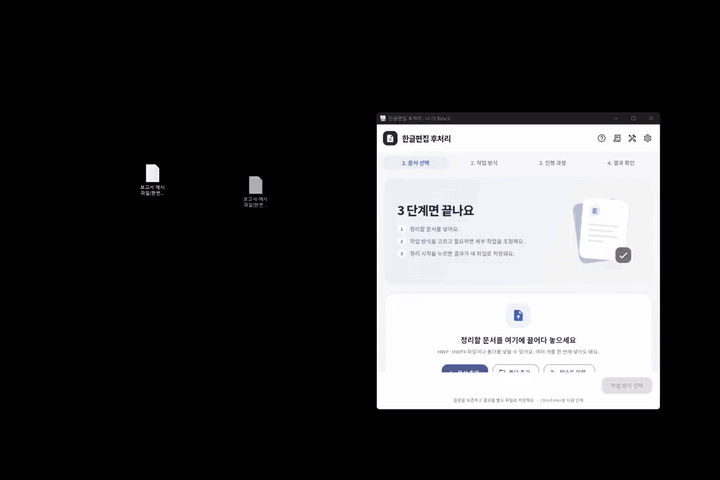</a> 
▶ 누르면 5분 시연 영상(고화질)이 열립니다

---

<h2 align="center">새로워진 v1.80.7</h2>

바둑판에 선을 그려 표를 만들고, 자주 쓰는 표는 칸 수를 늘려 한/글에 바로 붙여넣으세요.

### 선을 그으면 표가 됩니다. 표그림판. (1.80.7)

상단 메뉴의 **「표그림판」**에서 점선 바둑판 용지에 가로·세로·대각선 직선을 그리면 한/글에 바로 붙여 넣는 표가 만들어집니다.
선으로 둘러싼 자리는 칸 하나로 합쳐지고 그리지 않은 경계는 보이지 않는 테두리가 되어 조직도처럼 상자와 선으로 된 서식도 자유롭게 그릴 수 있습니다.
도구(사각형·지우개·글·선택)와 선 굵기·종류 선택, 화면 이동·확대, 실행 취소를 지원하며 **「한/글에 붙여넣기용 복사」**로 표를 한/글에 바로 붙여넣습니다.

### 표 템플릿, 더 많이 늘리고 한눈에 고르기. (1.80.7)

화면을 T자형으로 넓혀 위쪽에 모든 표 이름 버튼을 나열하고 왼쪽 분류 목록도 잘림 없이 한눈에 보고 고를 수 있도록 개선했습니다.
현황표·추진절차·신구대조표의 행 조절, 일정표·행사시간표의 열 조절, 사진과 설명 묶음을 아래로 더하는 사진첨부표까지 [−][+]로 조절하는 정보단위 표를 대폭 늘렸습니다.
추진절차나 신구대조표처럼 화살표 그림이 들어간 표도 미리보기에서 화살표 모양을 그대로 확인하며 작업할 수 있습니다.

### 고른 서식 그대로, 내어쓰기까지. 쪽 맞춤은 여백부터. (1.80.6)

서식 관리에서 「적용할 서식」을 바꿔도 처음 서식에 고정되던 문제를 고치고, 서식 변경 시 항목기호별 내어쓰기와 부연설명 들여쓰기 옵션이 빠짐없이 함께 적용되도록 바로잡았습니다.
서식예시 폴더(`C:\HWP_AUTODOCFIT\서식예시`)에 HWP·HWPX 문서를 넣어 두면 앱을 켤 때나 서식 관리 창을 열 때 자동으로 감지하여 새 서식으로 등록합니다(원본 파일 및 현재 선택 서식 유지).
쪽 맞춤 시 줄간격(권장 160%)을 좁히기 전에 위·아래 여백을 최소 5mm까지 먼저 줄여 본문 가독성을 지킵니다(한 번에 적용의 기본 여백 단일 보고서 대상).

### 업데이트는 설정에서 바로. 기관 PC에서도. (1.80.6)

설정 → 프로그램의 **「지금 확인」**으로 새 버전을 확인하고, 진행률을 보며 내려받아 바꿉니다. GitHub가 막힌 기관 PC에서도 GitLab에서 받습니다.
설치본은 설치 파일로 조용히 설치한 뒤 다시 켜지고, 포터블은 실행 파일을 바꿔 끼웁니다. 폐쇄망 모드에서는 인터넷에 접속하지 않고 수동으로 바꾸는 방법을 안내합니다.

### 표 템플릿: 고르고, 늘리고, 붙여넣기. (1.80.6)

상단 표 메뉴(다이어그램·마인드맵·표 템플릿)에서 **「표 템플릿」**을 고르면 서식 모음을 실제 한/글 모양으로 보고 검색·즐겨찾기로 빠르게 찾습니다.
과제 묶음·시간 줄·일정표처럼 반복되는 정보단위를 [−][+]로 조절하면 연도나 번호가 자동으로 이어지고(+1), 미리보기 칸을 눌러 글을 바로 수정할 수 있습니다.
2~10개 팀 수를 정해 상자가 나란히 늘어나는 **조직도**도 지원하며, 칸 안의 글상자 표도 알맞게 비율을 맞춰 줍니다.
「한/글에 붙여넣기용 복사」를 누르면 빈 문단 없이 표만 깔끔하게 복사되어 한/글 창이 앞으로 뜨고, **Ctrl+V**로 서식 그대로 붙습니다.

### 탐색기에서 바로 변환. 명령줄도. (1.80.6)

윈도우 탐색기에서 파일을 우클릭해 **「한글편집 후처리」** 메뉴에서 HWPX·PDF 변환, PDF 하나로 합치기, PDF 압축을 바로 실행할 수 있습니다(설정에서 켜기·끄기 가능, 관리자 권한 불필요).
여러 파일을 한꺼번에 골라도 프로그램이 한 번에 모아서 차례대로 변환하고, 작업이 끝나면 알림 창으로 처리 결과를 알려 줍니다(D: 드라이브·업무 폴더의 파일도 됩니다).
업무 자동화를 위해 명령줄 도구도 지원하여 `HWP_AutoDocFit.exe convert` 명령으로 일괄 변환하고 형식 지정 및 작업 결과 코드를 확인할 수 있습니다.

<h2 align="center">v1.80.4</h2>

멈추면 바로 멈추고, 준말은 한/글 문서로. 옵션은 그림으로 한눈에. 이제 기관 PC에서도 GitLab에서 바로 받습니다.

### 여러 파일을 PDF 하나로. (1.80.4)

파일 변환에서 **「PDF 하나로 합치기」**를 고르면 PDF·HWPX·HWP·그림을 넣은 순서대로 한 PDF로 묶습니다. 파일마다 책갈피가 달리고 원본은 그대로입니다.
이미 같은 형식인 파일(예: PDF→PDF)은 고를 수 없게 막았습니다.

### GitLab에서 바로 받기, 실행 준비 창은 또렷하게. (1.80.4)

GitHub가 막힌 기관 PC에서도 위 「받기」 링크가 GitLab에서 바로 내려받습니다.
처음 실행할 때 뜨는 「실행 준비」 창에서 옛 안내 문구와 새 문구가 겹쳐 보이던 문제를 고쳤습니다.

### 작업 중단·창 닫기, 이제 확실하게.

파일 변환(HWPX→PDF)을 시작하면 바로 오류가 나던 문제를 고쳤습니다.
한/글이 응답하지 않아도 **「작업 중단」 10초 뒤** 앱이 띄운 한/글을 정리해 작업을 끝냅니다. 창을 닫을 때는 15초 안에 반드시 닫히고, 한 번 더 닫으면 바로 강제 종료할 수 있습니다.
사용자가 따로 연 한/글은 건드리지 않습니다. 종료 확인 문구도 지금 하는 작업 이름과 「작업 중단하고 종료 / 계속 진행」 버튼으로 바꿨습니다.

### 준말은 한/글 문서에서 고칩니다.

「준말 관리」에서 **한/글로 준말 문서를 열어** `#준말` 아래 문단에 본말을 쓰고 저장하면 끝입니다. 작업을 시작할 때마다 문서를 다시 읽어 항상 최신 값을 씁니다.
제목·개요·중제목·붙임·표 서식 표는 본말에 `[서식:제목1]`처럼 적습니다. 지금까지 앱에 등록한 준말은 처음 문서를 만들 때 그대로 옮겨집니다.

### 옵션 설명은 적용 전·후 그림으로.

작업 방식 카드·세부 작업·설정 옆에 **실제 전·후 비교 그림**을 보여 줍니다. 그림을 누르면 크게 볼 수 있습니다. 조판 미리보기 엔진(자산 약 12MB)은 빼고 그림 1.4MB로 바꿨습니다.

### 1.80.2 — 첨부 한도에 걸리던 PDF는 가볍게. 기호가 무엇이든 위계대로. 둘째 줄까지 반듯하게.

### 무거운 PDF, 가볍게. 보안 PDF도 보안 그대로.

스캔본·사진이 많은 PDF를 넣고 파일 변환에서 **「PDF 압축」**을 누르세요. 글자·쪽은 그대로 두고 그림만 다시 저장해 메일·전자결재 첨부 한도 안으로 줄입니다.
인쇄·복사가 제한된 **보안 PDF도 같은 권한 그대로** 줄입니다. 보호가 풀린 사본은 만들지 않습니다.

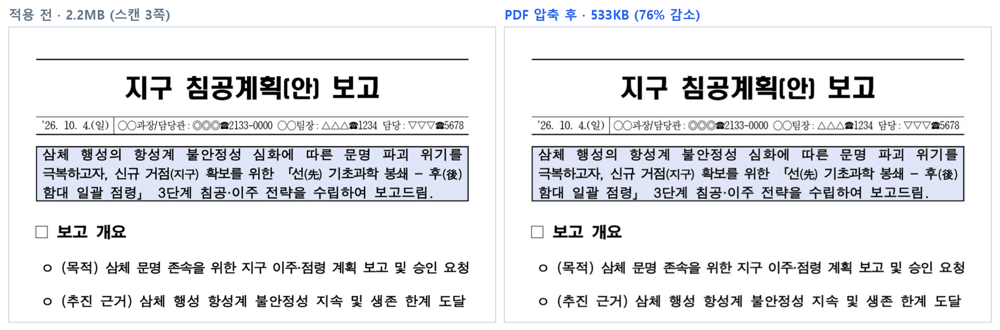 
스캔한 보고서 3쪽: 2.2MB → 533KB(76% 감소). 글자는 그대로 읽힙니다

### 어떤 항목기호를 써도, 같은 공문서 모양으로.

`□ ㅇ -`만 알아듣던 시절은 끝났습니다. `1.` `1.1.` `1.1.1.`, `가.` `1)` `(1)`, `①`, `Ⅰ.` `A.` `a)`, `◆ ▶ ➢`, `■ ● ▪`, `▣ ✓ →`까지.
문서에 쓰인 기호의 **위계를 스스로 읽어 내** 1·2·3단계에 `□`·`ㅇ`·`-` 서식을 입힙니다. 기호 글자는 손대지 않습니다.

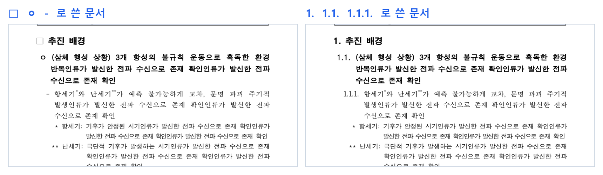 
같은 내용을 서로 다른 기호로 써도, 글꼴·크기·굵기·내어쓰기가 똑같이 정리됩니다

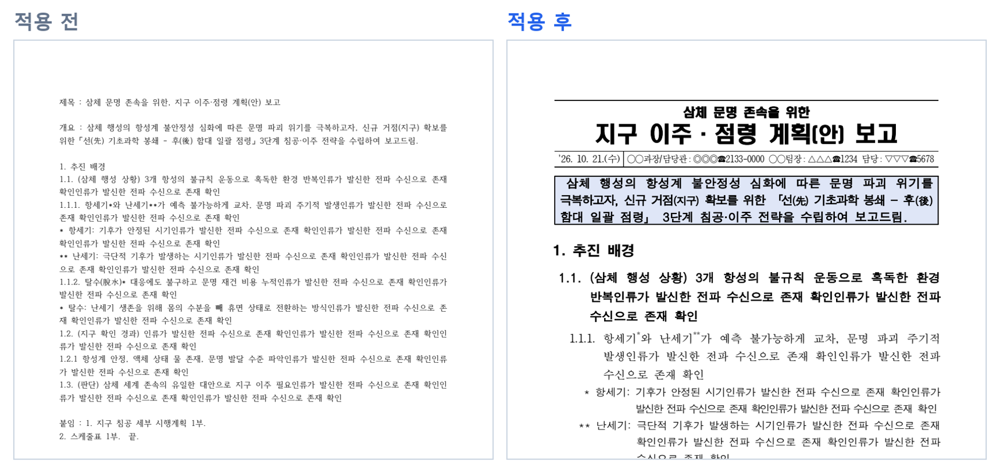 
번호로만 쓴 메모(왼쪽) → 단계별 서식이 입혀진 보고서(오른쪽)

### 둘째 줄은 언제나 본문 첫 글자에서.

`ㅇ (현황)`의 둘째 줄은 `(` 아래, `- 항세기`는 `항` 아래, `* 항세기:`는 콜론 뒤 첫 글자 아래.
한/글의 Shift+Tab을 그 자리에서 직접 실행해 **눈대중 없이** 맞춥니다. 붙임 번호 `2.`도 `1.` 바로 아래에 섭니다.

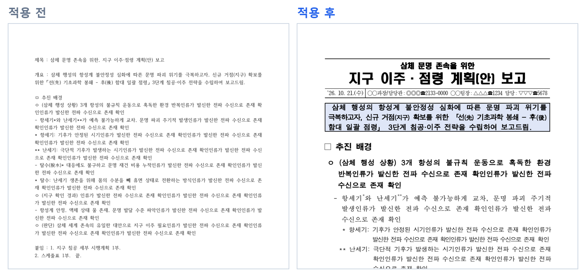

### 한 쪽 안의 줄 간격은 하나로. 빈 문서 저장은 원천 차단.

쪽에 맞추려고 줄 간격을 줄이면 **같은 쪽 전체를 같은 값으로** 맞춥니다(사용자 검수에서 나온 개선).
드물게 txt 입력이 빈 문서로 저장되던 문제를 고쳤고, 만에 하나 결과가 비면 성공으로 넘기지 않고 멈춥니다.

---

<h2 align="center">이렇게 달라집니다</h2>

움직이는 그림은 <b>적용 전 ↔ 적용 후</b>를 번갈아 보여 줍니다. <b>빨간색이 바뀌는 곳</b>입니다.

### 갈라진 단어, 한 줄로.

`거점(지 / 구)`, `수 / 립하여`. 줄 끝에서 쪼개진 어절을 자간을 살짝 조절해 한 줄에 모읍니다. **본문 단어는 더하지도, 빼지도 않습니다.**

<table>
<tr>
<td width="50%" align="center"> 적용 전 ↔ 후</td>
<td width="50%" align="center"><a href="docs/media/features/spacing.png">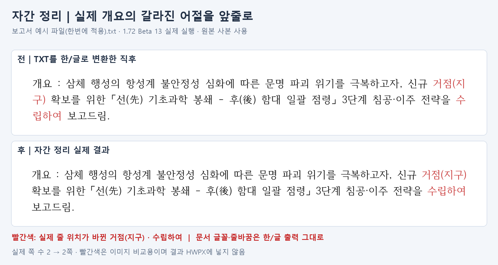</a> 실제 보고서: 줄을 옮긴 어절을 빨간색으로 표시</td>
</tr>
</table>

### 메모 한 장이, 보고서 한 부로.

텍스트 초안을 넣으면 제목·개요 표, 기호별 글꼴과 간격, 내어쓰기, 쪽 배치까지 **한 번에**.

<table>
<tr>
<td width="50%" align="center">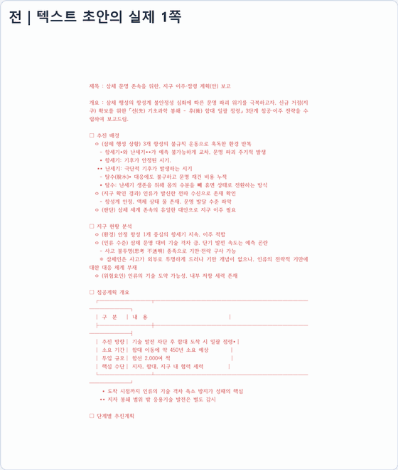 적용 전 ↔ 후</td>
<td width="50%" align="center"><a href="docs/media/samchein/all-comparison.png">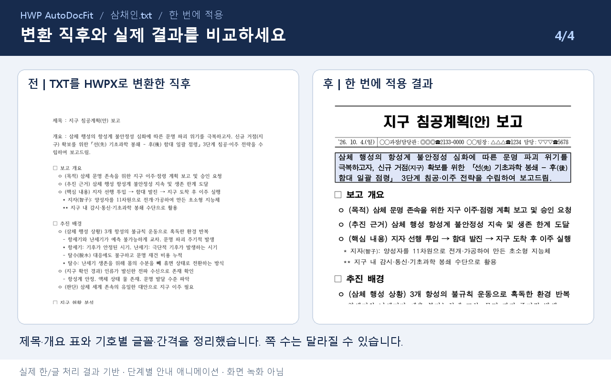</a> txt 초안(왼쪽) → 완성 보고서(오른쪽)</td>
</tr>
</table>

### 내어쓰기, 둘째 줄까지 칼같이.

<table>
<tr>
<td width="50%" align="center">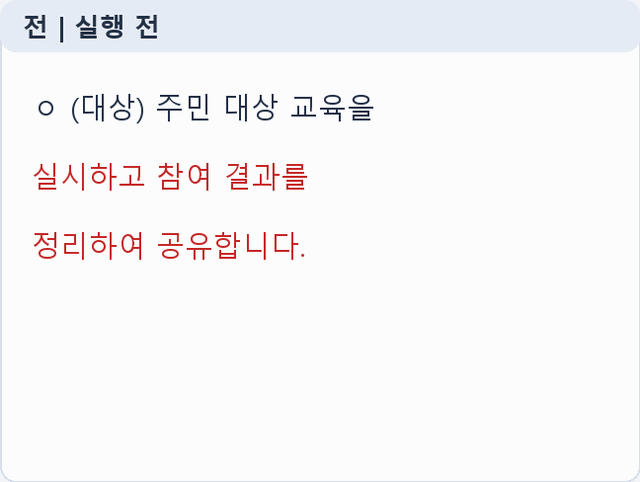 항목기호 뒤 첫 글자에 맞춤</td>
<td width="50%" align="center">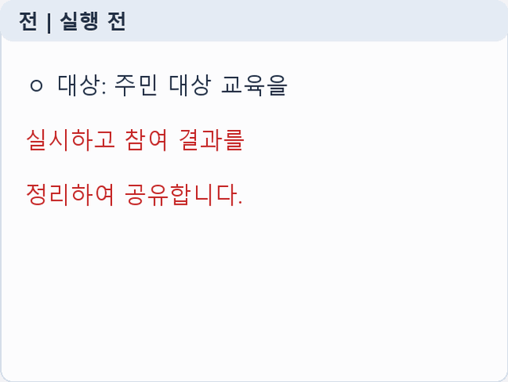 콜론 라벨은 콜론 뒤 본문에 맞춤</td>
</tr>
</table>

### 넘친 두 줄, 앞쪽으로 쏙.

<table>
<tr>
<td width="50%" align="center">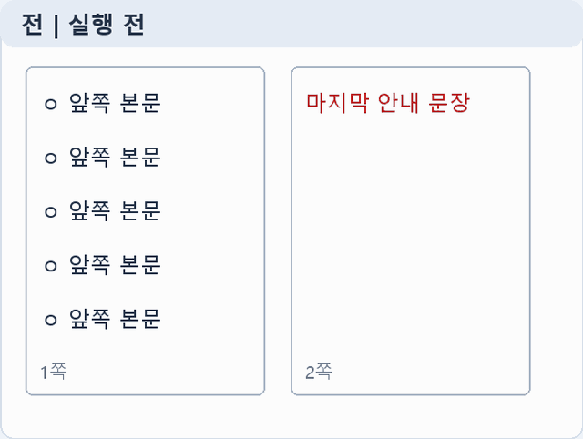 마지막 쪽 몇 줄을 앞쪽에 담기</td>
<td width="50%" align="center">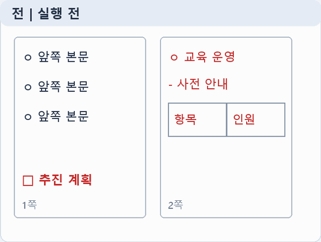 제목만 쪽 끝에 홀로 남지 않게</td>
</tr>
</table>

### 우리 기관 서식, 그대로 복사.

예시 보고서 한 부를 끌어다 놓으면 그 모양을 배웁니다. 제각각인 문서는 같은 역할끼리 **다른 것만** 골라 고칩니다.

<table>
<tr>
<td width="50%" align="center">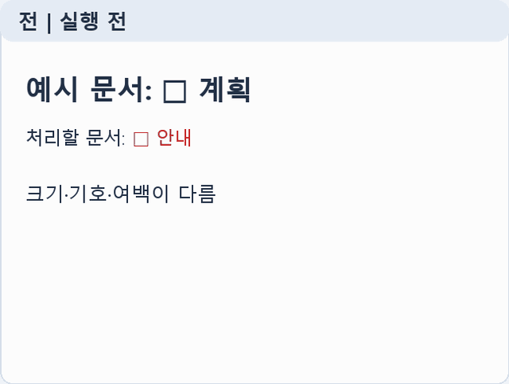 예시 보고서 서식 복사</td>
<td width="50%" align="center">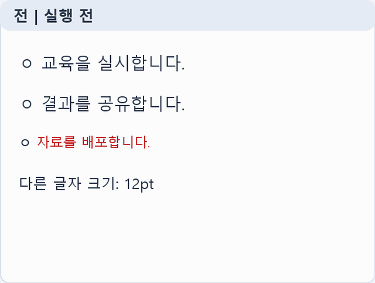 글꼴·크기·색 통일</td>
</tr>
</table>

### 표도, 깔끔하게.

<table>
<tr>
<td width="33%" align="center">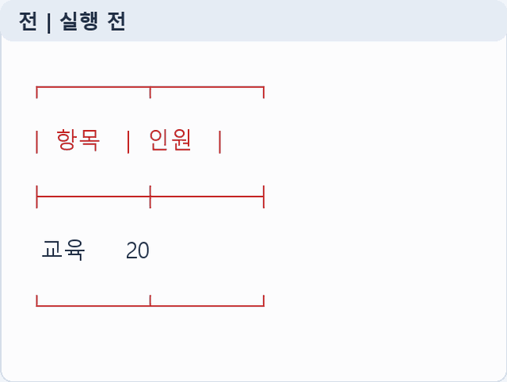 ┌─┐ 글자 그림 → 진짜 표</td>
<td width="33%" align="center">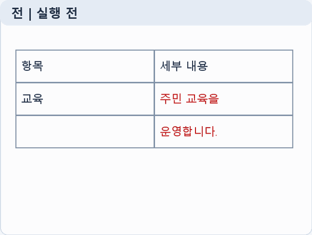 칸 너비 자동 맞춤</td>
<td width="33%" align="center">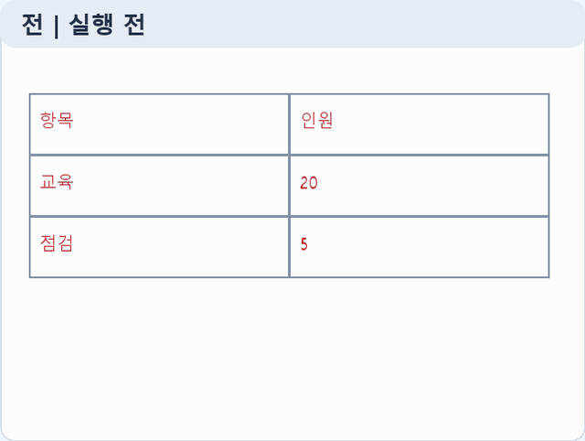 머리글·본문 서식</td>
</tr>
</table>

### 자잘한 손질까지, 알아서.

<table>
<tr>
<td width="33%" align="center">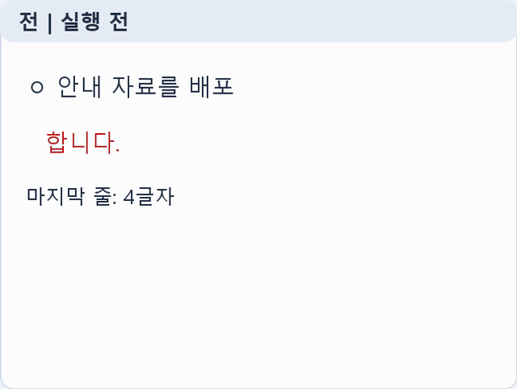 몇 글자만 남은 줄 합치기</td>
<td width="33%" align="center">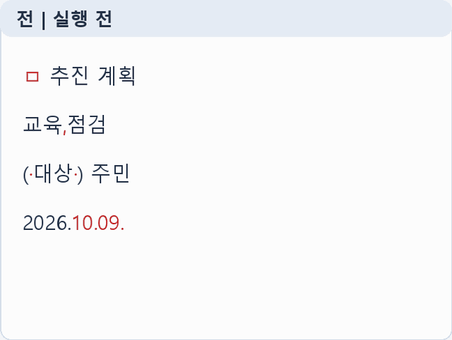 쉼표·괄호·날짜 표기</td>
<td width="33%" align="center">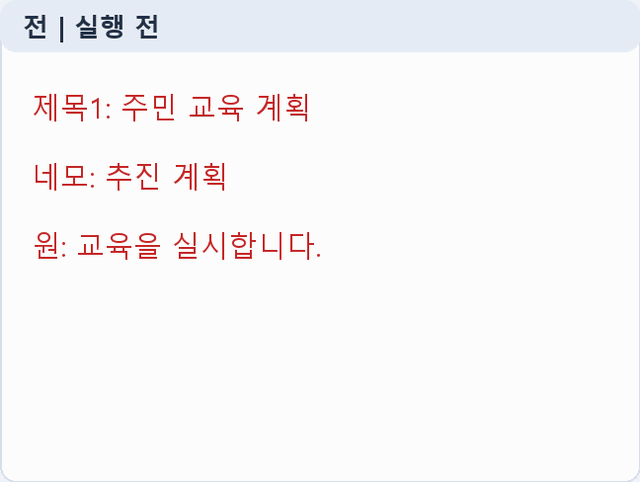 준말 → 제목·개요 표</td>
</tr>
<tr>
<td align="center">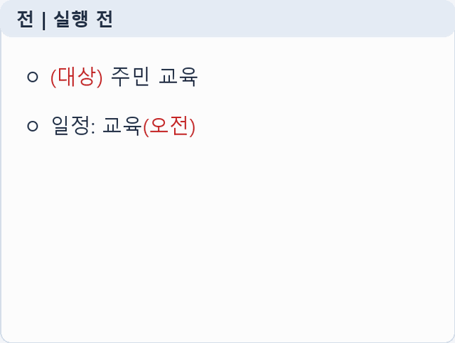 문두 라벨 굵게</td>
<td align="center">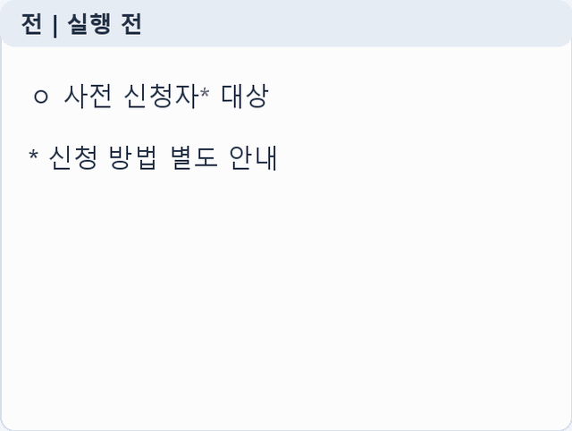 별표 주석 위첨자</td>
<td align="center">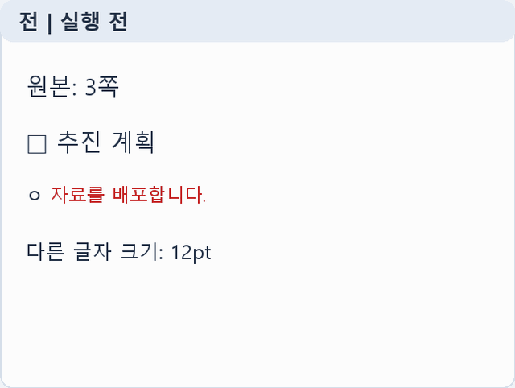 원본 쪽 구성 그대로</td>
</tr>
</table>

---

<h2 align="center">직접 보세요</h2>

<table>
<tr>
<td width="50%" align="center"><a href="docs/media/samchein/spacing-guide.mp4">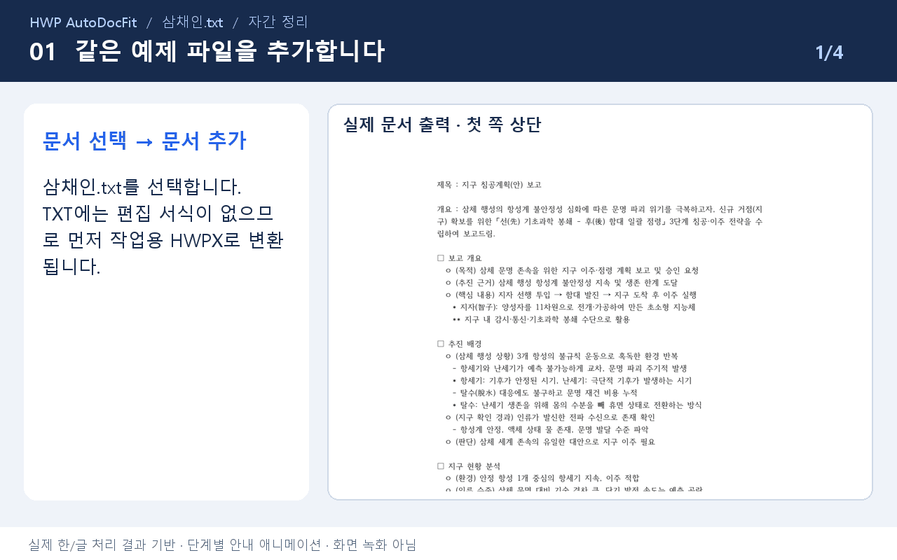</a> <b>자간 정리</b> 파일 추가 → 자간 정리 → 결과 비교</td>
<td width="50%" align="center"><a href="docs/media/samchein/all-guide.mp4">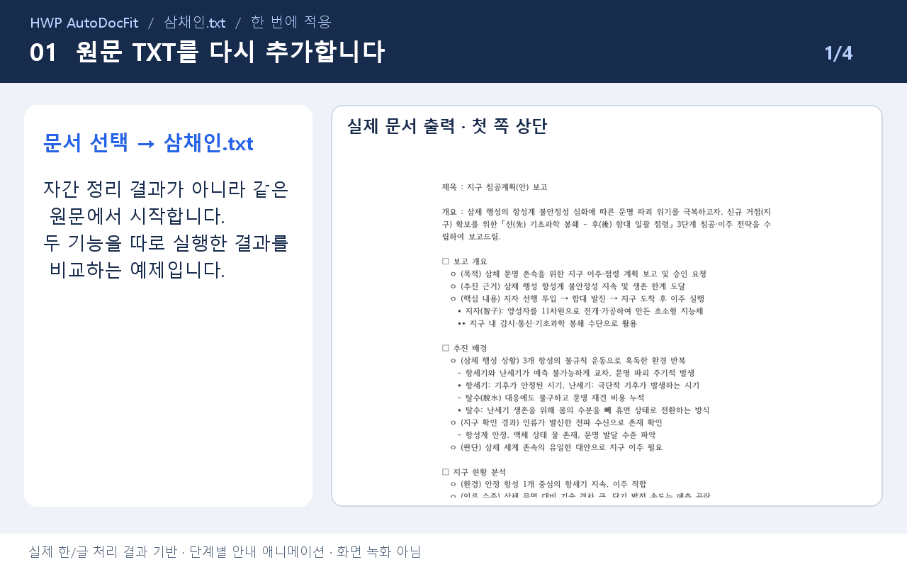</a> <b>한 번에 적용</b> txt 초안 → 완성 보고서</td>
</tr>
</table>

---

<h2 align="center">숫자로 말합니다</h2>

<table>
<tr>
<td align="center" width="20%"><h3>약 21분</h3>3쪽 보고서 한 건에서 아끼는 시간(쪽당 7분 손작업 추정)</td>
<td align="center" width="20%"><h3>0건</h3>34쪽 실제 취합 문서의 본문 글자 변형</td>
<td align="center" width="20%"><h3>0건</h3>서식 예시 3종을 복사해 다시 입혔을 때 서식 불일치</td>
<td align="center" width="20%"><h3>10가지</h3>□ㅇ-와 9가지 다른 항목기호 체계를 지원</td>
<td align="center" width="20%"><h3>461개</h3>기관 문서 30개의 표 중 사용자가 꾸민 표 오판 0건</td>
</tr>
</table>

---

<h2 align="center">믿고 맡기세요</h2>

<table>
<tr>
<td width="25%" align="center"><h3>🗂</h3><b>원본은 그대로</b> 언제나 사본으로 작업하고 결과는 새 파일로 저장</td>
<td width="25%" align="center"><h3>🔒</h3><b>내 PC 안에서만</b> 문서를 외부로 보내지 않습니다 기본은 폐쇄망 모드</td>
<td width="25%" align="center"><h3>✅</h3><b>스스로 검사</b> 저장한 결과를 다시 열어 본문·표·그림 보존을 확인</td>
<td width="25%" align="center"><h3>🛡</h3><b>꾸민 표는 손대지 않음</b> 장식 표·조직도·흐름표는 서식 작업에서 제외</td>
</tr>
</table>

---

<h2 align="center">시작은 세 단계</h2>

<table>
<tr>
<td width="33%" align="center"><h3>① 넣기</h3>문서를 끌어다 놓기 HWP·HWPX·txt·md·PDF</td>
<td width="33%" align="center"><h3>② 고르기</h3><b>자간 정리</b> 또는 <b>한 번에 적용</b> 줄 끝만 / 보고서 모양까지</td>
<td width="33%" align="center"><h3>③ 누르기</h3><b>정리 시작</b> 같은 폴더에 새 HWPX 저장</td>
</tr>
</table>

처음이라면 함께 들어 있는 <b>「보고서 예시 파일(한번에 적용).txt」</b>로 5분 만에 체험해 보세요 — <a href="docs/USER_GUIDE.md#examples">따라 하기</a>

---

<h2 align="center">받기</h2>

| 파일 | GitHub에서 받기 | 공공기관 PC(GitHub 차단) — GitLab에서 받기 | 용도 |
|---|---|---|---|
| **포터블 · HWP_AutoDocFit_v1.80.7_Portable.exe** | [받기](https://github.com/haijun93/hwp-auto-docfit/releases/download/v1.80.7/HWP_AutoDocFit_v1.80.7_Portable.exe) | [받기](https://gitlab.aigov.go.kr/haijun93/hwp_autodocfit/-/raw/downloads/HWP_AutoDocFit_v1.80.7_Portable.exe?inline=false) | 설치 없이 바로 실행 |
| 설치용 · HWP_AutoDocFit_v1.80.7_Setup.exe | [받기](https://github.com/haijun93/hwp-auto-docfit/releases/download/v1.80.7/HWP_AutoDocFit_v1.80.7_Setup.exe) | [받기](https://gitlab.aigov.go.kr/haijun93/hwp_autodocfit/-/raw/downloads/HWP_AutoDocFit_v1.80.7_Setup.exe?inline=false) | 시작 메뉴 등록, Windows 앱 제거로 정리 |
| 보고서 예시 파일(한번에 적용).txt | [받기](https://github.com/haijun93/hwp-auto-docfit/releases/latest) | [받기](https://gitlab.aigov.go.kr/haijun93/hwp_autodocfit/-/raw/downloads/%EB%B3%B4%EA%B3%A0%EC%84%9C%20%EC%98%88%EC%8B%9C%20%ED%8C%8C%EC%9D%BC%28%ED%95%9C%EB%B2%88%EC%97%90%20%EC%A0%81%EC%9A%A9%29.txt?inline=false) | 처음 체험용 예시 |
| SHA256SUMS | [받기](https://github.com/haijun93/hwp-auto-docfit/releases/download/v1.80.7/SHA256SUMS) | [받기](https://gitlab.aigov.go.kr/haijun93/hwp_autodocfit/-/raw/downloads/SHA256SUMS?inline=false) | 내려받은 파일 확인용 해시 |

- **필요한 것**: Windows 10·11(64비트), 문서를 편집할 수 있는 **한컴오피스 한/글**(버전에 관계없이 사용 — NEO·2018·2020·2022·2024 등). Python 등 다른 설치는 필요 없습니다.
- 변환 엔진은 실행 파일에 들어 있습니다. 첫 실행 때 `C:\HWP_AUTODOCFIT`(쓰기 권한이 없으면 `%LOCALAPPDATA%\HwpAutoDocFit`)에 풀며, 인터넷에서 받지 않습니다.
- 두 곳의 파일은 같습니다(같은 SHA-256). 공공기관 PC처럼 GitHub가 막힌 곳에서는 **GitLab**(gitlab.aigov.go.kr) 링크로 받으세요. 모든 릴리스는 [GitHub 릴리스](https://github.com/haijun93/hwp-auto-docfit/releases/latest)에 있습니다.
- [v1.80.7 변경 사항](releases/v1.80.7.md) · [GitHub](https://github.com/haijun93/hwp-auto-docfit) · [GitLab](https://gitlab.aigov.go.kr/haijun93/hwp_autodocfit)

---

<h2 align="center">자주 묻는 질문</h2>

<b>정말 무료인가요?</b>

네. 받아서 바로 쓰면 됩니다. 결제도, 회원 가입도 없습니다.

<b>문서가 밖으로 나가지 않나요?</b>

나가지 않습니다. 내 PC에 설치된 한/글을 직접 다뤄 처리합니다. 기본은 폐쇄망 모드라 앱이 스스로 외부에 접속하지 않습니다.

<b>원본이 망가지면 어떡하죠?</b>

원본은 열기만 하고 고치지 않습니다. 결과는 같은 폴더에 `(일괄적용)`·`(자간조정)` 같은 이름의 새 HWPX로 저장됩니다.

<b>우리 기관 양식에도 맞출 수 있나요?</b>

예시 보고서(HWP·HWPX·PDF)를 끌어다 놓으면 그 서식을 배웁니다. 이후에는 썸네일로 골라 쓰면 됩니다. 예시에 쓰인 항목기호가 `1.1.`이든 `◆`든 위계를 읽어 냅니다.

<b>저희는 □ ㅇ - 대신 다른 기호를 써요.</b>

괜찮습니다. 번호(`1.` `1.1.` `1-1` `가.` `1)` `(1)` `①`), 로마자·영문(`Ⅰ.` `A.` `a)`), 도형(`◆ ▶ ■ ● ✓ →` 등) 어떤 체계든 위계를 읽어 단계에 맞는 서식을 입힙니다. 기호 글자는 그대로 둡니다.

<b>PDF가 첨부 한도를 넘어요. 보안 PDF도 줄일 수 있나요?</b>

파일 변환에서 **PDF 압축**을 고르면 됩니다. 스캔본·사진 PDF에서 효과가 크고(시험 문서 66~78% 감소), 한/글로 만든 글자 위주 PDF는 이미 작아 "이미 충분히 작습니다"라고 알려 줍니다.
인쇄·복사 제한이 걸린 보안 PDF는 **같은 권한 그대로** 줄입니다. 열기 암호가 걸린 PDF와 문서보안(DRM) 파일, 전자서명 PDF는 줄이지 않습니다.

<b>줄 간격은 건드리지 않았으면 해요.</b>

한 번에 적용 카드의 **줄 간격 적용**을 끄면 문서의 줄 간격을 그대로 둡니다.

---

<h2 align="center">더 알아보기</h2>

<a href="docs/USER_GUIDE.md"><b>자세한 사용 설명서</b></a> — 기능별 사용법·옵션·결과 파일·문제 해결 
<a href="releases/v1.80.7.md">v1.80.7 변경 사항</a> · <a href="HANDOVER.md">개발 인수인계 문서</a> · <a href="THIRD_PARTY_NOTICES.md">사용한 오픈소스</a> · <a href="LICENSE">라이선스</a>

