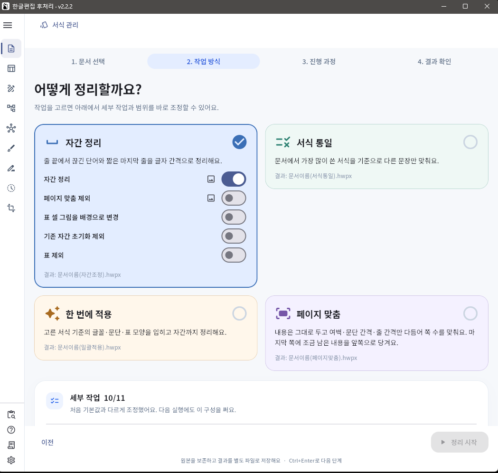
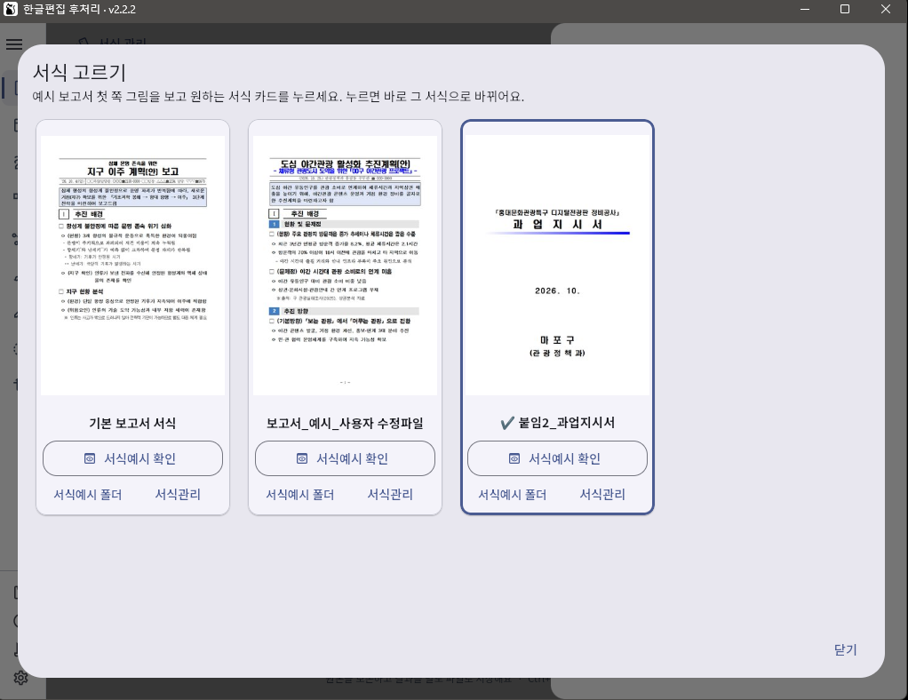
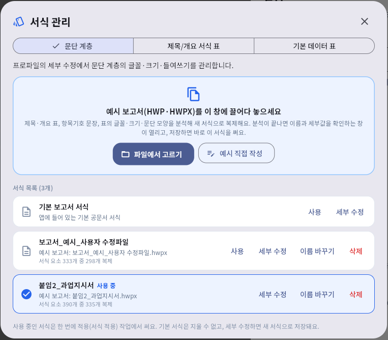
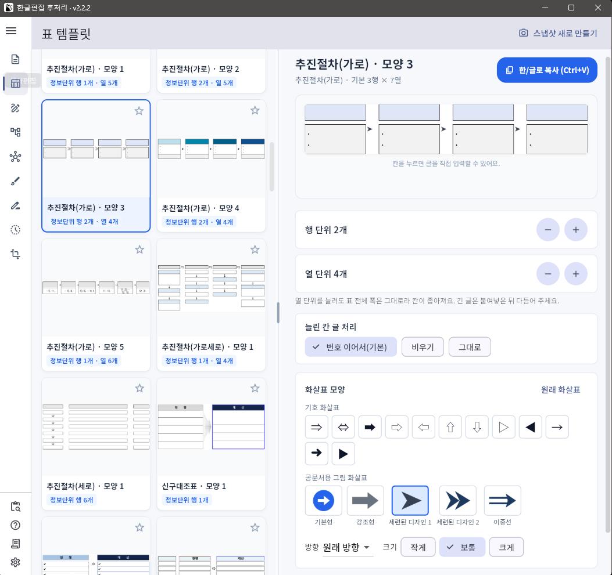
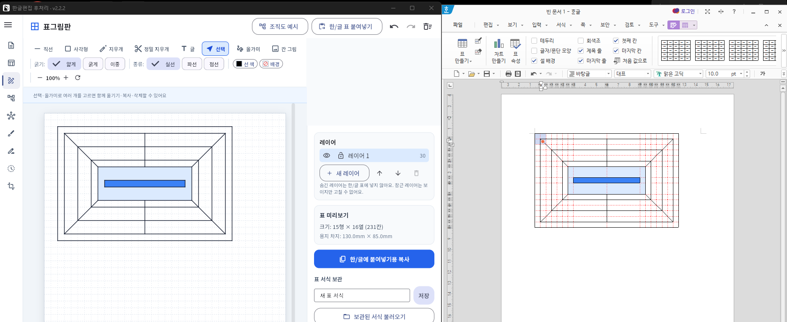
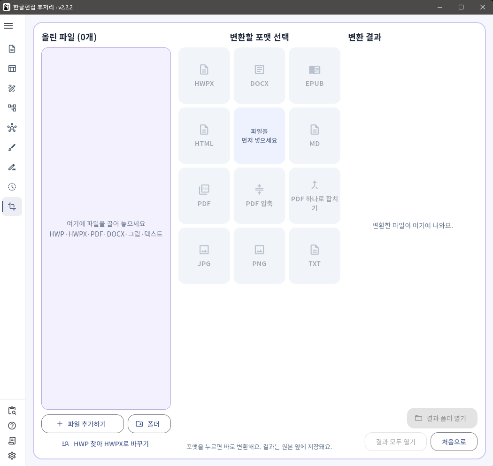
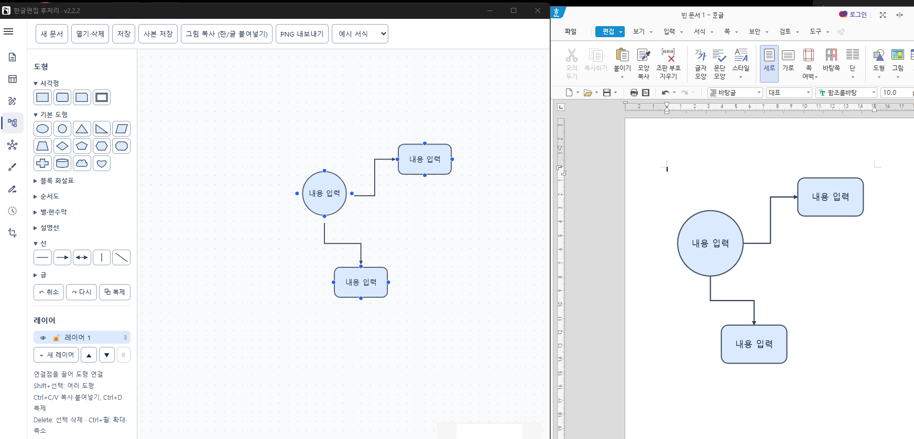
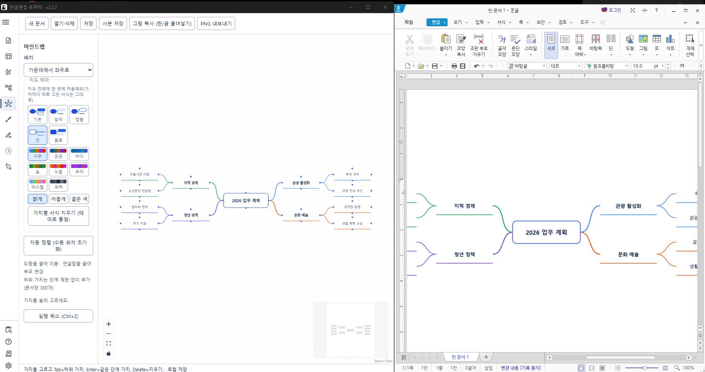
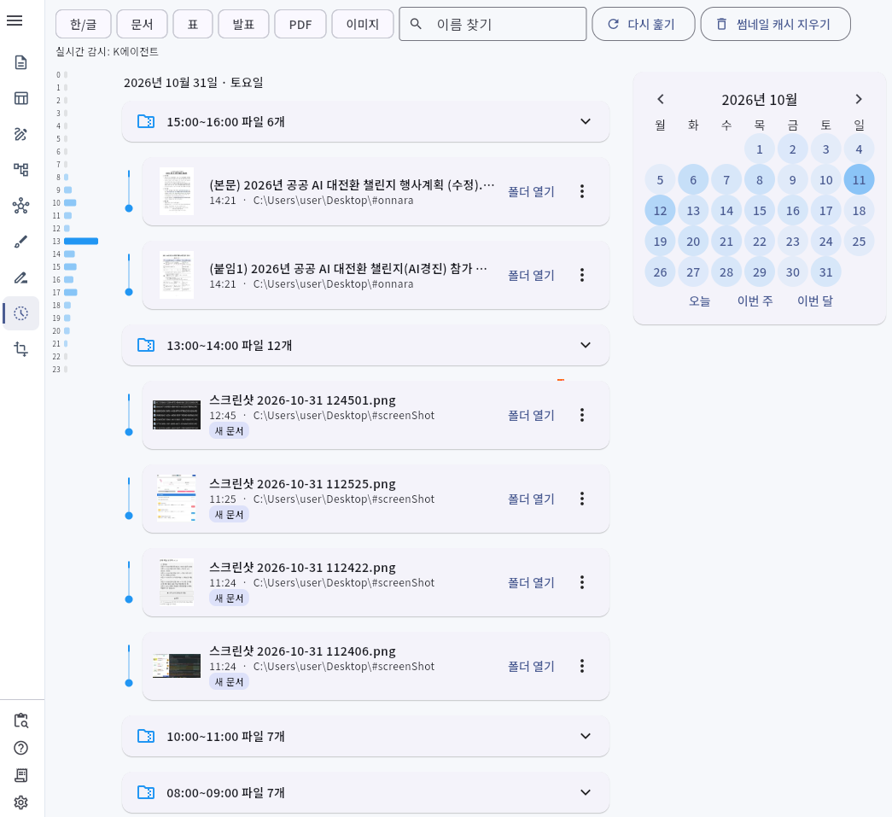
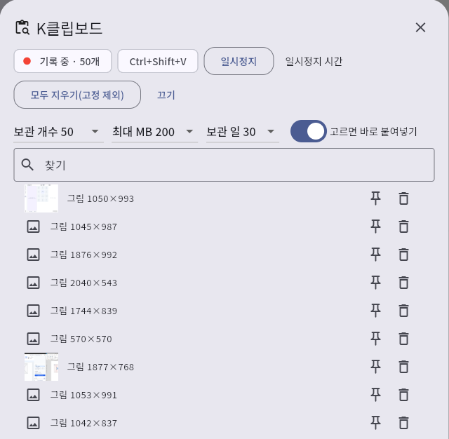

<h1 align="center">한글편집 후처리</h1>

<strong>한/글 문서 작업, 이제 한 곳에서</strong>

이제 표 만들지 마세요. 서식 맞추기부터 몽땅클립보드까지 8가지 기능을 한 곳에서 씁니다.

<strong>v2.2.2 · Windows 10·11 · 무료 · 한/글 설치 필요</strong>

<table align="center">
<tr>
<td align="center" width="50%"><strong>무설치(포터블)</strong> 받아서 더블클릭하면 바로 실행  <a href="https://github.com/haijun93/hwp-auto-docfit/releases/download/v2.2.2/HWP_AutoDocFit_v2.2.2_Portable.exe">포터블 다운로드</a></td>
<td align="center" width="50%"><strong>설치용</strong> 시작 메뉴·제어판에 등록  <a href="https://github.com/haijun93/hwp-auto-docfit/releases/download/v2.2.2/HWP_AutoDocFit_v2.2.2_Setup.exe">설치 파일 다운로드</a></td>
</tr>
</table>

## 8가지 기능

### 1. 문서서식 맞추기

문서를 넣고 작업 방식을 고른 뒤 정리를 시작하면 됩니다. 입력 문서는 보존하고 결과는 새 파일로 저장합니다.

- **자간 정리**: 줄 끝에서 끊긴 단어와 짧은 마지막 줄을 자간으로 다듬습니다.
- **서식 통일**: 문서에서 가장 많이 쓴 서식을 기준으로 다른 문장 모양을 맞춥니다.
- **한 번에 적용**: 고른 서식의 글꼴·문단·표 모양을 한 번에 적용합니다.
- **페이지 맞춤**: 내용을 바꾸지 않고 간격을 다듬어 쪽 수를 맞춥니다.

#### 예시 보고서로 서식 복제

HWP·HWPX 보고서를 불러오면 제목·개요 표, 항목기호 문장, 표의 글꼴·크기·문단 모양을 분석해 새 서식으로 등록합니다.

<table>
<tr>
<td width="50%"></td>
<td width="50%"></td>
</tr>
</table>

### 2. 표 템플릿

추진절차(가로·세로), 신구대조표 등 공문서에서 자주 쓰는 표를 고릅니다. 반복 정보단위의 행·열을 `+`·`−`로 조정하고, 화살표 기호와 공문서용 그림 화살표의 방향·크기를 선택한 뒤 `Ctrl+V`로 한/글에 붙여 넣습니다.

### 3. 표그림판

모눈 캔버스에 직선·사각형·화살표를 그리면 한/글에서 편집할 수 있는 표가 됩니다. 선 굵기와 종류, 색, 칸 배경을 조정하고 자주 쓰는 표 서식은 보관해 다시 불러옵니다.

### 4. 파일 변환

파일이나 폴더를 추가하고 원하는 포맷을 누르면 변환 결과가 원본 옆에 저장됩니다. HWPX·DOCX·EPUB·HTML·MD·PDF·JPG·PNG·TXT 변환과 PDF 합치기·압축을 지원합니다. 폴더 속 HWP를 찾아 HWPX로 한 번에 바꿀 수도 있습니다.

### 5. 다이어그램

도형을 놓고 연결점을 이어 업무 흐름도와 순서도를 만듭니다. 레이어로 겹친 도형을 관리하고 결과를 한/글에 붙여 넣거나 PNG로 저장합니다.

### 6. 마인드맵

`Tab`으로 하위 가지를, `Enter`로 같은 단계의 가지를 추가합니다. 테마와 배치를 고르고 자동 정렬한 뒤 한/글에 붙여 넣습니다.

### 7. 파일 타임라인

오늘·이번 주·이번 달 작업한 파일을 시간순으로 살펴봅니다. 시간대별 묶음과 종류별 필터를 사용하고, 썸네일과 파일명으로 확인한 뒤 원본 폴더를 엽니다.

### 8. 몽땅클립보드

복사한 텍스트·그림·파일·폴더 경로를 보관하고 다시 붙여 넣습니다. `Ctrl+Shift+V`로 목록을 열고, 검색하거나 자주 쓰는 항목을 고정할 수 있습니다. 보관 개수·용량·기간을 설정할 수 있습니다.

<strong>한글편집 후처리 하나로 문서를 정리하고, 표를 만들고, 파일을 찾으세요.</strong> <a href="https://github.com/haijun93/hwp-auto-docfit/releases/tag/v2.2.2">v2.2.2 다운로드 및 릴리스 정보</a>

