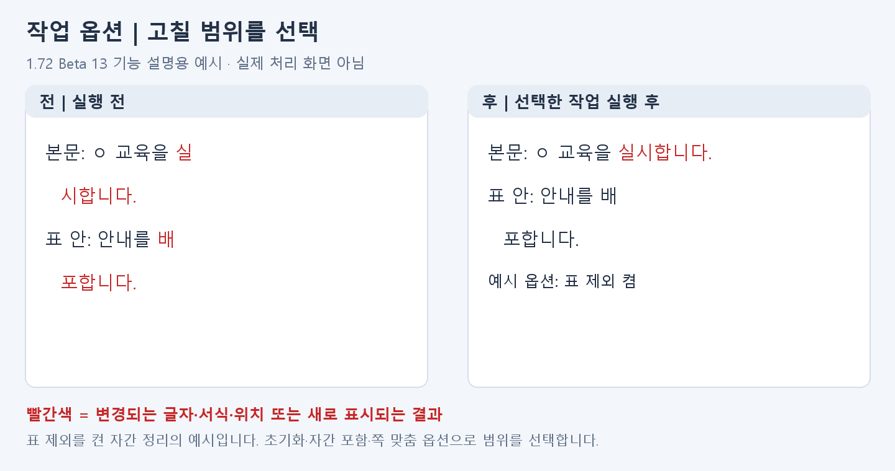
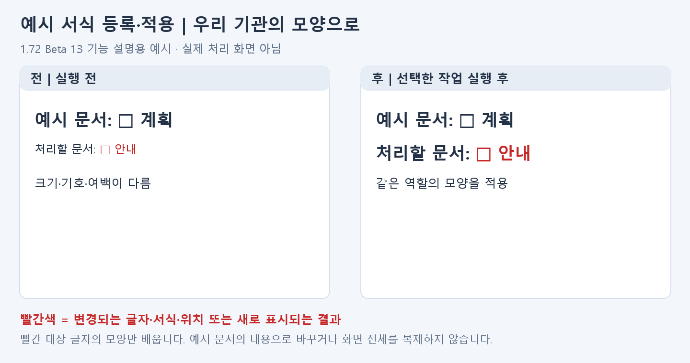
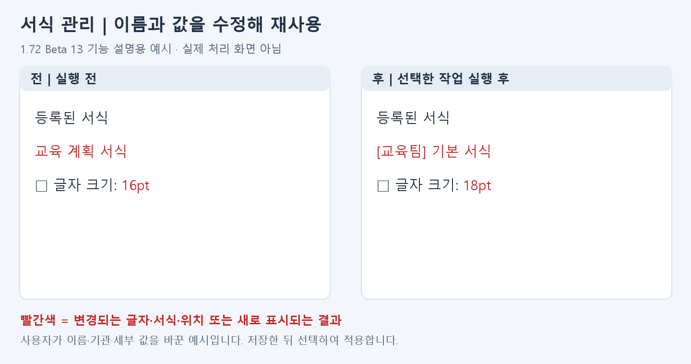
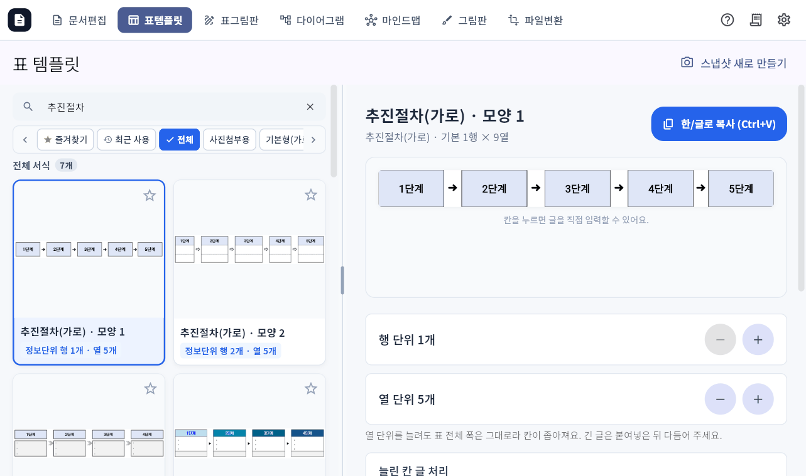
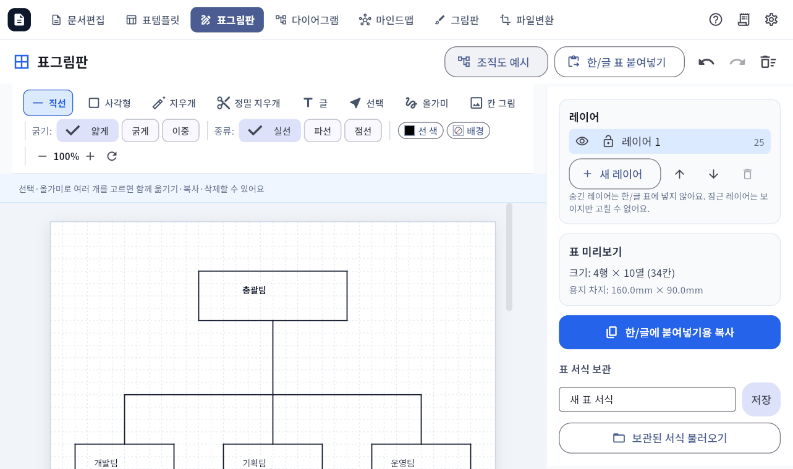
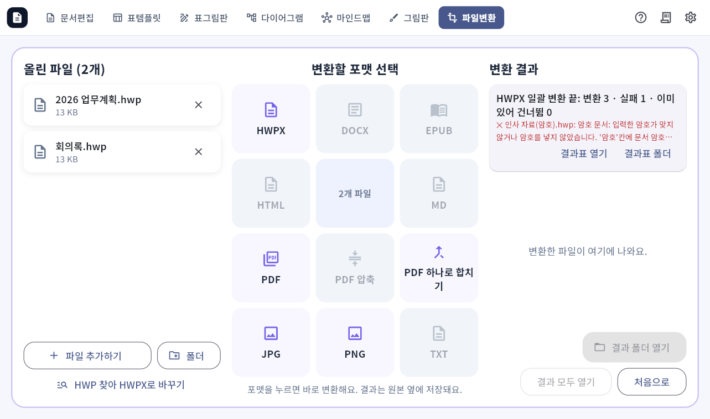
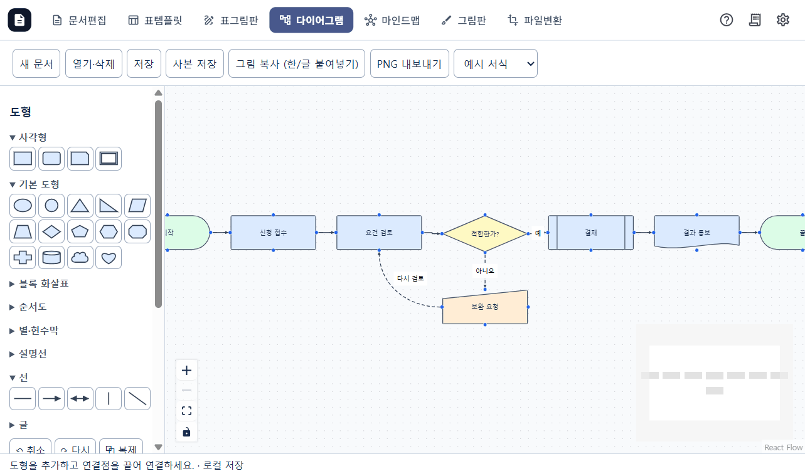
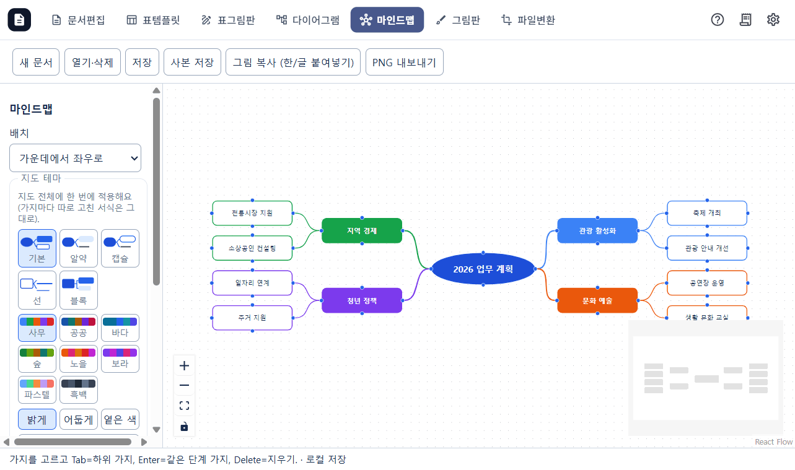

<h1 align="center">한글편집 후처리</h1>

<strong>한/글 문서 정리부터 표·도식 제작, 파일 관리까지 한 곳에서</strong>

반복되는 문서 작업을 줄이고, 보고서와 업무 자료를 더 빠르게 완성하세요.

<strong>Windows 10·11 · 무료 · 문서 편집에는 한/글 필요</strong>

<a href="https://github.com/haijun93/hwp-auto-docfit/releases/latest">최신 버전 다운로드</a>

## 주요 기능

### 문서 모양 정리

줄 끝에서 끊긴 단어와 짧은 마지막 줄을 자간으로 정리하고, 문서에서 많이 쓰인 서식을 기준으로 문장 모양을 통일합니다. 기본 보고서 양식이나 예시 문서에서 가져온 사용자 서식을 적용해 글꼴·문단·표 모양을 맞출 수도 있습니다. 원본은 보존하고 결과를 새 파일로 저장합니다.

### 예시 문서의 서식 재사용

HWP·HWPX 보고서를 분석해 제목과 개요 표, 항목 기호 문장, 표의 글꼴·크기·문단 모양을 서식으로 등록하고 다른 문서에 적용합니다.

<table>
<tr>
<td width="50%"></td>
<td width="50%"></td>
</tr>
</table>

### 표 템플릿과 표그림판

추진절차와 신구대조표 등 자주 쓰는 표 템플릿의 행·열을 조정해 한/글에 붙여 넣습니다. 표그림판에서는 선·화살표·색·칸 배경을 직접 구성해 편집 가능한 표로 만들고, 자주 쓰는 모양을 저장해 다시 사용할 수 있습니다.

<table>
<tr>
<td width="50%"></td>
<td width="50%"></td>
</tr>
</table>

### 파일 변환

파일이나 폴더를 추가해 HWPX, DOCX, EPUB, HTML, Markdown, PDF, 이미지, 텍스트 등으로 변환합니다. PDF 합치기·압축과 폴더 안 HWP 문서의 일괄 HWPX 변환도 지원합니다. 변환 결과는 원본을 덮어쓰지 않고 원본 옆에 저장합니다.

### 다이어그램과 마인드맵

도형과 연결선을 배치해 업무 흐름도·순서도를 만들고, 가지를 추가해 마인드맵을 정리합니다. 완성한 결과는 한/글에 붙여 넣거나 이미지로 저장할 수 있습니다.

<table>
<tr>
<td width="50%"></td>
<td width="50%"></td>
</tr>
</table>

### 파일 타임라인

오늘·이번 주·이번 달에 작업한 파일을 시간순으로 확인합니다. 날짜와 파일 종류로 좁혀 보고, 미리보기와 파일명으로 찾은 뒤 원본 폴더를 열 수 있습니다.

### 몽땅클립보드

복사한 텍스트·그림·파일·폴더 경로를 모아 두고 다시 사용합니다. `Ctrl+Shift+V`로 기록을 열어 검색하고, 자주 쓰는 항목을 고정하거나 보관 개수·용량·기간을 설정할 수 있습니다.

## 시작하기

1. [최신 실행 파일 다운로드](https://github.com/haijun93/hwp-auto-docfit/releases/latest)에서 설치형 또는 포터블 파일을 받습니다.
2. Windows 10·11에서 실행합니다. Python이나 Node.js를 별도로 설치할 필요는 없습니다.
3. 문서 편집 기능은 한컴오피스 한/글이 설치된 PC에서 사용할 수 있습니다. 한/글이 필요 없는 변환 기능도 있습니다.

자세한 사용법은 [사용자 안내서](docs/USER_GUIDE.md)를 참고하세요. 개발·빌드 방법은 [개발 안내](docs/DEVELOPMENT.md)에 있습니다.
