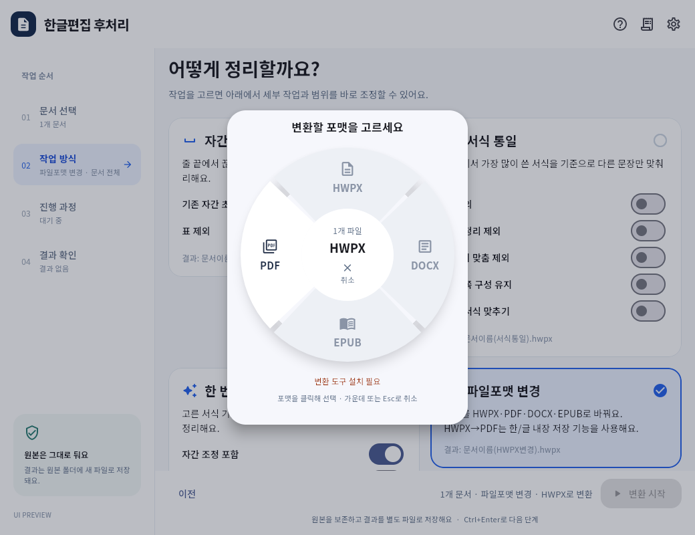

# Alpha 7 — 플로팅 파일포맷 선택·HWPX 직접 PDF 저장

검증일: 2026-10-14. 개발판: **1.74 Alpha 7**. 공개 배포선 `main`은 변경하지 않는다.

## 사용자 흐름

1. 문서를 추가하고 `파일포맷 변경` 카드를 선택한다.
2. 별도 플로팅 도넛 창에서 HWPX/PDF/DOCX/EPUB 중 사용할 출력 포맷을 고른다.
3. 선택하면 창이 닫히고 요약에 결과 형식이 반영된다. `변환 시작`을 누르면 처리한다.
4. `변환 포맷 선택` 버튼으로 다시 열 수 있다. 가운데 취소·Esc·바깥 클릭은 기존 선택을 유지한다.

이미 파일포맷 변경 모드라면 파일 추가/드롭 뒤 창이 자동으로 열린다. 주기적 상태 조회로 같은 창이 반복해서 열리지는 않는다. 사용할 수 없는 포맷은 비활성화하고 설치/입력 조건을 안내한다. 선택창이 열린 동안 조건이 바뀌어도 최신 상태를 반영한다.



위 이미지는 실제 Release 웹 번들을 Edge에서 렌더링한 **시험용 상태 미리보기**다. PDF만 준비된 상황을 의도적으로 구성했다. 실제 문서 변환 완료 화면은 아니다. 폭 1,040px·420px에서 모두 확인했다.

## Filee 벤치마킹 범위

[Filee의 RadialWindow](https://github.com/KnifeLemon/Filee/blob/main/src/Filee.App/Views/RadialWindow.axaml)와 [DonutMenu](https://github.com/KnifeLemon/Filee/blob/main/src/Filee.App/Controls/DonutMenu.cs)의 별도 팝업·동일 크기 도넛 조각·호버 강조·비활성 사유·중앙 취소 방식을 참고했다. Flutter 코드로 새로 구현했으며 조각의 실제 경로로 클릭 영역을 제한한다.

현재 구현은 **앱 내부 Flutter 플로팅 팝업**이다. Filee의 앱 바깥 투명 최상위 OS 창, 시스템 전체 파일 드래그 감시/단축키 후킹을 그대로 복제한 것은 아니다. 포맷 선택이 곧 변환 실행을 뜻하지 않으며 기존 앱의 `변환 시작` 단계를 유지한다.

## HWPX → PDF: 추가 변환기 설치 없이

원인: 변환 준비 상태가 HWPX 직접 PDF 저장에도 kordoc/Node.js를 요구하는 공통 조건을 적용했다. 실제 변환 함수에는 한/글의 `SaveAs(..., "PDF", ...)` 경로가 있었지만 화면에서 이를 사용하지 못하게 막았다.

개선:

- HWPX만 선택한 PDF 작업은 한/글 COM 준비 여부만 확인한다. Node.js/kordoc/Pandoc/PDF 프린터는 필요 없다.
- HWPX는 직접 저장하므로 Markdown 재생성 경로를 거치지 않는다. 기존 필수 실행 환경인 **한/글 2020의 설치·COM 등록은 여전히 필요**하다. 한/글 자체를 앱에 배포/내장한 것은 아니다.
- 독립 COM 세션에서 문서를 열고 별도 임시 PDF로 저장한다. PDF 서명을 확인한 뒤 이미 존재하는 결과를 덮어쓰지 않고 게시한다.
- 문서 정리는 `Clear(1)`을 사용해 저장 질문에 의한 대기를 방지한다.
- 다른 입력의 PDF 작업은 kordoc → HWPX → 한/글 PDF 저장을 유지한다. DOCX/EPUB는 kordoc과 Pandoc이 필요하다.

## 실행·효율성 검토

- kordoc 다운로드 경로는 정확한 `4.21.30`으로 고정했다. 명시적으로 설치한 로컬 엔진은 해당 설치본을 사용한다.
- Windows npm `.cmd` 래퍼 대신 Node의 JS 진입점을 인자 배열로 실행한다. 문서 경로가 배치 셸 문법으로 해석되지 않게 한다.
- 실행 중 패키지 자동 다운로드는 기본 차단하며, 명시적 허용 변수 없이는 설치된 엔진만 사용한다.
- 외부 실행 파일/버전 준비 조회를 Tk 이벤트 루프 밖으로 이동하고 30초 캐시한다. 엔진이 없을 때 불필요한 Node 버전 조회를 생략한다.
- 포맷 선택 컴포넌트를 `lib/features/conversion`으로 분리했다. 화면 변경 후 웹 자산을 재빌드했다.
- Windows에서 Flutter 분석 래퍼의 LSP 응답 오류가 관찰되어 빌드 스크립트는 같은 SDK의 `dart analyze --fatal-infos`를 직접 실행한다. 분석·시험·번들 검사 중 하나라도 실패하면 빌드는 중단된다.
- `pub get`이 생성한 Windows 플러그인 등록 파일을 실제 의존성과 일치시켰다. 네이티브 문서 엔진 연결을 완료했다는 뜻은 아니다.

## 최종 시험 결과

| 검증 | 결과 | 범위 |
|---|---|---|
| Python 전체 unittest | 1,038건, 실패/오류 0, skip 1 | Windows 가상환경, 588.611초 |
| Flutter 전체 시험 | 34건 통과, skip 0 | `DOCFIT_TEST_PYTHON` 지정하여 네이티브 IPC 시험 포함 |
| Dart 정적 분석 | 문제 0 | 같은 Flutter SDK의 analyzer |
| Flutter Release 웹 빌드 | 성공 | `build_flutter.ps1`, 로컬 폰트/CanvasKit 번들 검사 통과 |
| 화면 렌더링 | 오류 0 | Edge, 폭 1,040px·420px, 외부 네트워크 차단 |
| 실제 kordoc HWPX 생성/재변환 | 성공 | 합성 Markdown 문서, 생성 HWPX 구조 검사 통과·원본 보존 |
| 실제 한/글 내장 PDF 저장 | 성공 | 합성 HWPX의 사본, 1쪽·18,089바이트·본문 추출 확인 |
| 원본·시험 사본 보존 | 성공 | PDF 변환 전후 SHA-256 일치 |

Python skip 1은 시험 계정에서 심볼릭 링크를 만들 수 없어 제외된 기존 도형 저장소 시험이다. 실제 PDF 저장 시험은 10.582초였으며 **한 문서의 동작 확인이지 베타 대비 속도 측정은 아니다**. `pypdf`는 생성물 검수용 시험 의존성으로만 사용했고 변환 엔진에는 쓰지 않았다.

전체 시험 로그에는 기존 MCP의 `PureWindowsPath.is_reserved()` 폐기 예정 경고가 남아 있다. 웹 빌드는 기존 Cupertino 폰트 참조 경고를 출력했지만 완료됐고 이 화면의 사용 아이콘은 렌더링 확인했다. 이 경고들을 실패·오류 또는 완전 무경고 상태로 바꿔 보고하지 않는다.

## 추가 검증·잔여 범위

- 실제 Windows 앱의 Alpha 7 실행은 확인했지만, 파일 선택 대화상자가 자동 조작 도구에 독립 창으로 노출되지 않아 **파일 선택부터 변환까지의 수동 UI 검증은 완료하지 않았다**. 화면 자동 조작은 중단했다. 선택/취소/API 흐름은 위젯·브리지 시험으로, PDF 생성은 실제 COM 시험으로 따로 확인했다.
- DOCX/EPUB 실문서 출력, 다양한 PDF/이미지 OCR 품질·서식 충실도는 도구가 갖춰진 환경에서 추가 검증해야 한다. 모든 파일의 원본 배치 재현이나 모든 환경의 무오류를 보장하지 않는다.
- 현재 전체 설정 대화상자는 Flutter다. 프로필 상세·일부 문서 검토/승인 대화상자에는 Tk 경로가 남아 있으며 네이티브 Flutter runner의 COM 이관도 별도 작업이다. UI 100% 전환 완료로 표시하지 않는다.
- 이번 변경은 알파 소스·로컬 웹 번들 반영이다. 베타/정식 EXE 릴리스나 `main` 승격은 실시하지 않는다.

## 재현 명령

```powershell
# 전체 Python 회귀시험
.\.venv\Scripts\python.exe -m unittest discover -s tests

# 네이티브 IPC를 포함한 Flutter 시험·분석·Release 웹 빌드
$env:DOCFIT_TEST_PYTHON = (Resolve-Path '.\.venv\Scripts\python.exe').Path
powershell -NoProfile -ExecutionPolicy Bypass -File build_flutter.ps1

# 선택 의존성 Playwright + 설치된 Edge를 사용하는 시험용 화면 검수
.\.venv\Scripts\python.exe scripts\preview_flutter.py --conversion

# 선택 의존성 pypdf를 사용하는 실제 COM 저장/원본 보존 검수
# --out은 아직 없는 새 시험 결과 폴더를 지정한다.
.\.venv\Scripts\python.exe scripts\smoke_pdf_conversion.py '시험문서.hwpx' --out 'scratch\새-PDF-시험'
```
