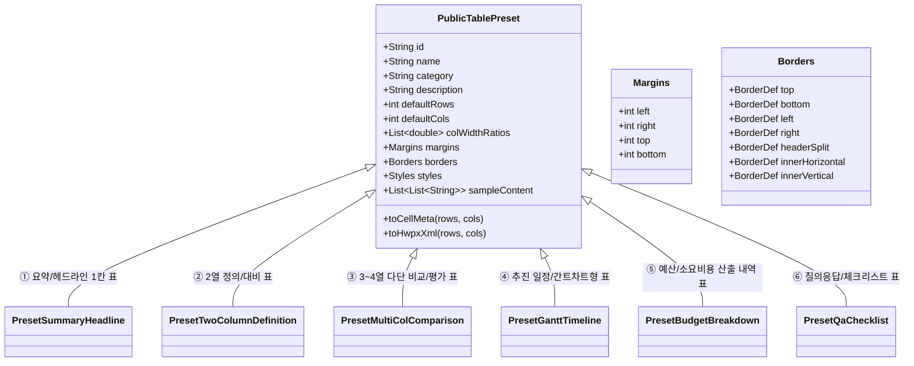

# HWP AutoDocFit 2.0 표 템플릿 고도화 설계 및 알파버전(2.0.0-alpha.1) 명세서

- **문서 버전**: v2.0.0-alpha.1
- **작성자**: 프로젝트 총괄 매니저 제미나이 1 & 코덱스 수석 아키텍트
- **기반 자료**: `docs/BENCHMARK_HWP_TABLE_TEMPLATES.md` (공공·비즈니스 표준 표 템플릿 6대 벤치마킹)
- **적용 대상**: `docfit_core/public_table_presets.py`, `docfit_core/table_units.py`, `docfit_app/table_units_service.py`, `flutter_ui/lib/features/table_units/`

---

## 1. 고도화 배경 및 설계 목적

기존 1.80.x 버전의 표 템플릿 기능은 서식 파일(`표 서식모음.hwpx`)에 의존하여 파일이 없거나 한컴오피스 COM 호환성 문제 발생 시 미리보기나 복사가 제한되는 취약점이 있었습니다. 또한 공공기관 실무자(중앙부처, 지자체, 공기업)가 가장 빈번히 작성하는 **핵심 6대 표준 서식(요약 상자, 2열 정의, 3~4열 비교, 간트차트, 예산 내역, Q&A 체크리스트)**이 정량화된 메트릭스로 프리셋화되어 있지 않았습니다.

본 2.0 알파버전 고도화 설계는 다음 3대 핵심 목표를 달성합니다:
1. **내장형 공공 표준 6대 프리셋 엔진(`public_table_presets.py`) 탑재**:
   - 외부 파일 및 COM 의존 없이 순수 파이썬/HWPX 엔진으로 실시간 셀 메타, 선 굵기, 색상, 여백, 한글 클립보드 복사를 100% 자립 지원.
2. **정밀 조판 메트릭스(HWPUnit) 1:1 직렬화**:
   - 행안부 편람 기준 셀 안쪽 여백(좌우 2.5mm / 상하 1.2mm = 708 / 340 HWP단위) 및 머리글 이중선(0.5mm) 자동 조판.
3. **Flutter UI 고도화**:
   - `TableUnitsScreen` 내 `🏛️ 공공 표준` 프리뷰 전용 카테고리 칩 및 표준 조판 가이드라인 카드(여백/테두리/폰트 스펙) 신설.

---

## 2. 6대 공공 비즈니스 표준 표 템플릿 아키텍처

---

## 3. 세부 6대 프리셋 명세

### ① 요약/헤드라인 1칸 표 (`pub_summary_headline`)
- **용도**: 장관/실국장 보고서 서두 핵심 요약 콜아웃 상자
- **구조**: 1행 1열 (100% 폭)
- **테두리**: 상하 굵은 실선 0.4mm (`#1A365D`), 좌우 선 없음(`NONE`)
- **배경음영**: 소프트 블루 `#EBF3FA` (12% 틴트)
- **여백**: 좌우 4.0mm (1,134 HWP단위), 상하 2.5mm (708 HWP단위)
- **글꼴**: 한컴돋움 10.5pt, 자간 -5%, 줄간격 140%

### ② 2열 정의/대비 표 (`pub_two_col_definition`)
- **용도**: 사업 개요(명칭, 기간, 주관, 내용), 용어 정의, 1:1 대비 서식
- **구조**: N행 2열 (좌 22% : 우 78%)
- **테두리**: 상하 실선 0.4mm, 좌우 선 없음, 중간 가로선 0.12mm (`#E2E8F0`), 열 구분선 0.12mm
- **배경음영**: 좌측 항목열 연회색 `#F2F4F7`, 우측 내용열 흰색 `#FFFFFF`
- **여백**: 좌우 2.5mm (708 HWP단위), 상하 1.2mm (340 HWP단위)
- **글꼴**: 항목열 한컴돋움 9.5pt Bold / 내용열 휴먼명조 9.5pt Regular

### ③ 3~4열 다단 비교/평가 표 (`pub_multi_col_comparison`)
- **용도**: 부처간/방안별 비교 평가, 지표별 달성도
- **구조**: N행 4열 (18% : 37% : 30% : 15%)
- **테두리**: 최상단 0.4mm, 머리글 하단 이중선 0.5mm (`DOUBLE_SLIM`), 최하단 0.4mm, 좌우 선 없음
- **배경음영**: 머리글 소프트 블루 `#DFE6F7`, 본문 지브라(홀수행 `#FFFFFF`, 짝수행 `#F8FAFC`), 하단 합계 `#ECEEF2`
- **글꼴**: 머리글 한컴돋움 9.5pt Bold / 본문 휴먼명조 9.0pt / 합계 한컴돋움 9.5pt Bold

### ④ 추진 일정/간트차트형 표 (`pub_gantt_timeline`)
- **용도**: 월별/분기별 타임라인 로드맵
- **구조**: N행 6열 (과제 24%, 세부 20%, 1~4분기 각 14%)
- **테두리**: 상하 0.4mm, 머리글 하단 이중선 0.5mm, 타임라인 내부 점선(`DOT`) 0.12mm
- **배경음영**: 머리글 `#E7EEF8`, 추진 활성 바 다크네이비 `#1A365D` (흰색 폰트), 보조 바 `#94BBE9`
- **여백**: 좌우 1.0mm (283 HWP단위), 상하 1.0mm (283 HWP단위)

### ⑤ 예산/소요비용 산출 내역 표 (`pub_budget_breakdown`)
- **용도**: 비목별 예산 편성 및 단가×수량 내역 산출
- **구조**: N행 5열 (비목 18%, 산출내역 32%, 단가 16%, 수량 14%, 금액 20%)
- **테두리**: 상단 0.4mm, 머리글 하단 이중선 0.5mm, 최하단 합계 이중선 0.5mm 마감
- **정렬**: 금액 및 단가 열 우측 정렬(RIGHT) 및 3자리 콤마 포맷
- **배경음영**: 머리글 `#F2F4F7`, 합계 행 `#E2E8F0`

### ⑥ 질의응답(Q&A) / 체크리스트 표 (`pub_qa_checklist`)
- **용도**: 현장 점검표, 자가진단, 대국민 Q&A
- **구조**: N행 4열 (연번 12%, 점검항목 48%, 점검기준 22%, 판정결과 18%)
- **테두리**: 상단 0.4mm, 머리글 하단 이중선 0.5mm, 하단 0.4mm, 좌우 개방
- **배경음영**: 적격 셀 소프트 그린 `#E6F4EA` (글자 `#188038`), 보완 셀 소프트 핑크 `#FCE8E6` (글자 `#D93025`)

---

## 4. 백엔드 및 프론트엔드 연동 설계

1. **`docfit_core/public_table_presets.py`**:
   - `PUBLIC_TABLE_PRESETS` 딕셔너리 및 `get_public_preset_descriptors()`, `build_preset_preview()`, `build_preset_hwpx()` 구현.
2. **`docfit_app/table_units_service.py`**:
   - `list()` 응답 시 `PUBLIC_TABLE_PRESETS`를 `"공공 표준"` 카테고리로 최상단 또는 전용 탭에 주입.
   - `preview()` 및 `copy()` 호출 시 템플릿 ID가 `pub_` 접두사를 가지면 `public_table_presets` 엔진에서 독립 생성.
3. **`flutter_ui/lib/features/table_units/table_units_screen.dart`**:
   - 카테고리 리본에서 `공공 표준` 선택 시 전용 아이콘(`🏛️`) 및 배지 렌더링.
   - 우측 상세 화면에 표준 조판 정보 카드(셀 여백, 추천 글꼴, 선 규격 안내) 노출.
