# 한글편집 후처리 — 자세한 사용 설명서

> 제품 소개와 다운로드는 [README](../README.md)에 있습니다. 이 문서는 기능별 사용법·옵션·문제 해결을 담은 설명서입니다(v1.80.2 기준).

# 자세한 사용 설명서

이번 버전에서 바뀐 점: **v1.80.2**는 파일 변환에 **PDF 압축**(글자·쪽은 그대로 두고 그림만 다시 저장, 보안 PDF는 같은 권한 유지)을 더했습니다. **v1.80.1**은 다양한 항목기호 체계(1.1., 1), 가., 도형 등)의 위계를 분석해 단계별로 □·ㅇ·- 서식을 일괄 적용하는 기능을 지원하고, txt 빈 문서 저장 오류와 첫 소제목 간격을 고쳤으며, 쪽 배치 후 줄 간격 혼재(같은 쪽 통일)를 해결했습니다. 1.80에서 내어쓰기(둘째 줄이 항목기호 뒤 본문 첫 글자에서 시작, 기본 서식 값 우선)와 붙임 번호 정렬, 서식 복사 재연(복사한 서식의 내어쓰기·왼쪽 여백을 그 서식의 예시 파일에서 그대로, 기호 뒤 낫표·반복 문장 포함), 항목기호 앞 빈칸(부연설명은 위 문단에 맞는 칸 수, 복사 서식은 예시에서 배운 칸 수), 자간 정리 원문 보존(연결 부호를 지우지 않음, 실패한 자간은 되돌림, 표 제외 시 한 칸 표도 제외)을 바로잡고 빈 문서 저장을 막았습니다([변경 사항](../releases/v1.80.1.md)). '서식 통일'은 v1.74부터 기본으로 글꼴·크기만 맞춥니다('전체 서식 맞추기' 옵션으로 전체 서식).

<b>기능별 자세한 설명과 옵션 위치 펼치기</b>

## 어떤 결과가 나오나요?

아래 기능 설명의 **전·후 비교 이미지에서 빨간색은 바뀌는 글자·서식·위치**입니다. 바뀌지 않는 부분은 검은색으로 표시합니다. 새 파일이나 검토 결과를 만드는 기능은 새로 생기는 정보를 빨간색으로 표시합니다.
**자간 정리·한 번에 적용의 두 이미지는 `test4`의 「보고서 예시 파일(한번에 적용).txt」 사본을 Beta 13으로 실제 처리하고 한/글 자체 PDF 출력으로 만든 사례**입니다. 나머지는 기능 설명용 도해입니다. 빨간색은 이미지의 비교 표시이며 결과 HWPX에는 넣지 않았습니다. 이미지를 누르면 크게 볼 수 있습니다.

### 1. 자간 정리 — 줄 끝에서 갈라진 단어를 한 줄로

줄 끝에서 `거점(지 / 구)`, `수 / 립하여`처럼 갈라진 어절을 자간을 조절해(장평 줄이기는 설정에서 켤 때만) 앞줄 또는 뒷줄에 모으도록 시도합니다. 글 내용은 유지하고 글자 간격·폭과 줄 배치를 바꿉니다.

[실제 사례의 실행·원본 보존 기록](media/features/test4-evidence.json) · **[▶ 이전 사례 영상 보기 — 24초](media/samchein/spacing-guide.mp4)** · [바로 따라 하기](#examples)

### 2. 한 번에 적용 — 텍스트 초안을 보고서 모양으로

**기본 서식 또는 등록한 예시 서식**을 기준으로 제목·개요 표, 기호별 글꼴·간격, 내어쓰기, 자간·쪽 배치 등 선택한 작업을 실행합니다. 글꼴과 문단 간격이 바뀌므로 결과 쪽 수는 늘거나 줄 수 있습니다.

[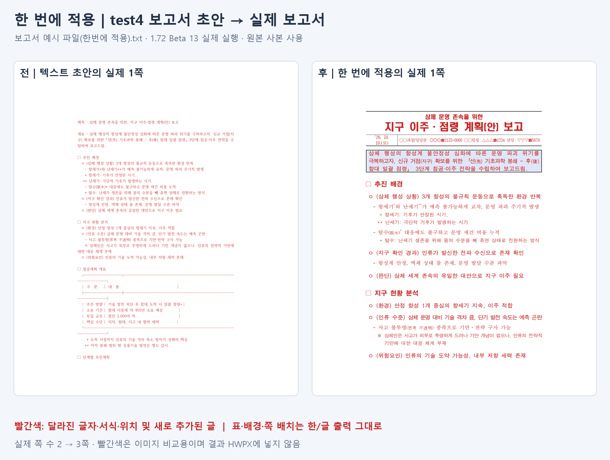](media/features/all-in-one.png)

[실제 사례의 실행·원본 보존 기록](media/features/test4-evidence.json) · **[▶ 이전 사례 영상 보기 — 24초](media/samchein/all-guide.mp4)**

> 영상은 **실제 한/글 처리 결과로 만든 단계별 안내 애니메이션**이며 앱 클릭 화면 녹화가 아닙니다. 재생되지 않으면 MP4를 내려받거나 아래 실습의 GIF 안내를 펼치세요. 예제는 **1.69 Beta 18**로 처리한 결과이며, 글꼴·설정에 따라 모양이 달라질 수 있습니다.

### 3. 내어쓰기 — 괄호는 기호 뒤, 콜론은 본문 시작에 맞춤

**Beta 14에서 괄호 라벨 뒤 본문에 맞추는 규칙을 삭제했습니다. 콜론 라벨 뒤 본문에 맞추는 규칙은 유지합니다.** 기본 내어쓰기 기준은 다음과 같습니다.

| 문장 형태 | 둘째 줄 이후 정렬 기준 |
|---|---|
| `ㅇ (대상) 주민…` | 항목기호 뒤 첫 글자 **`(`**에 맞춤. `(대상)` 뒤 `주민`에 맞추지 않음 |
| `ㅇ 대상: 주민…` | 콜론 뒤 본문 첫 글자 **`주`**에 맞춤 — 기존 규칙 유지 |
| `ㅇ (방식) : 주민…` | 콜론이 있으므로 콜론 뒤 본문 첫 글자 **`주`**에 맞춤 |

**괄호 라벨:** 빨간 둘째·셋째 줄이 항목기호 뒤 괄호 시작선으로 이동합니다.

[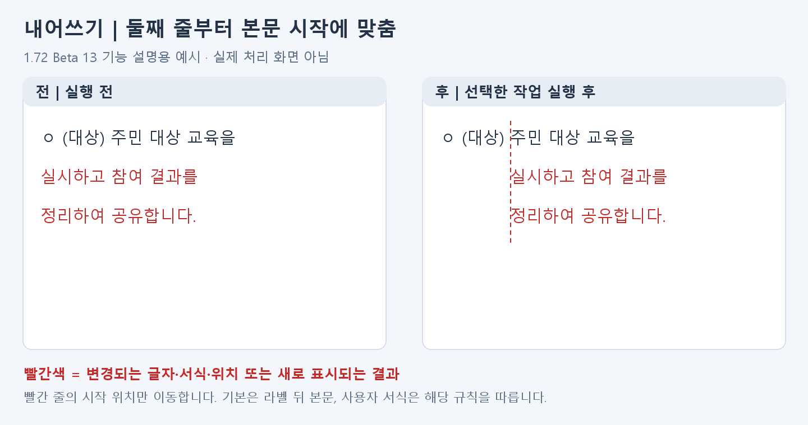](media/features/hanging-indent.png)

**콜론 라벨:** 빨간 둘째·셋째 줄이 콜론 뒤 본문 시작선으로 이동합니다. 이 기준은 유지됩니다.

[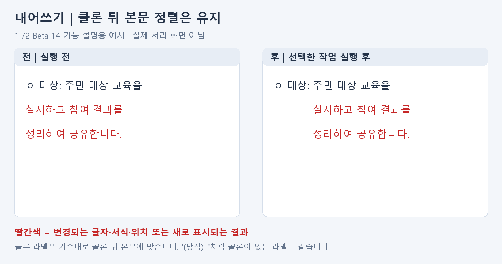](media/features/hanging-indent-colon.png)

등록한 사용자 서식의 **기호 뒤 / 고정 값 / 없음** 규칙을 선택하면 그 규칙을 따릅니다. 삭제된 **괄호 라벨 뒤 정렬**과 문두 라벨의 굵게·괄호 크기 조정은 별개입니다.

**한 번에 적용 → 세부 작업 → 최종 서식 기준 내어쓰기**에서 선택합니다. 서식 통일도 고친 문장의 내어쓰기를 맞추며, **자간 정리 제외**와 별도로 동작합니다.

### 어떤 항목기호도 위계로 정리

십진 다단(1. / 1.1. / 1.1.1.), 공문서 번호(1. / 가. / 1)), 원문자·도형 기호 등 어떤 항목기호가 쓰여도 문서 내 위계를 자동으로 판별합니다.
분석된 위계에 맞춰 1·2·3단계에 각각 □·ㅇ·- 서식(글꼴·크기·굵게·앞 빈칸·내어쓰기·간격)을 적용하며, 원문의 기호 글자는 그대로 보존합니다.
예시 보고서를 등록해 서식을 복사할 때도 비표준 기호의 위계를 동일하게 분석해 서식을 재연합니다.

### 4. 쪽 수 맞춤 — 마지막 쪽에 조금 남은 글을 앞쪽으로

마지막 쪽에 몇 줄만 남은 경우 **문단 간격 등을 조절해 앞쪽에 들어가도록 시도**합니다. 들어갈 공간이 부족하면 쪽 수가 그대로일 수 있습니다.

[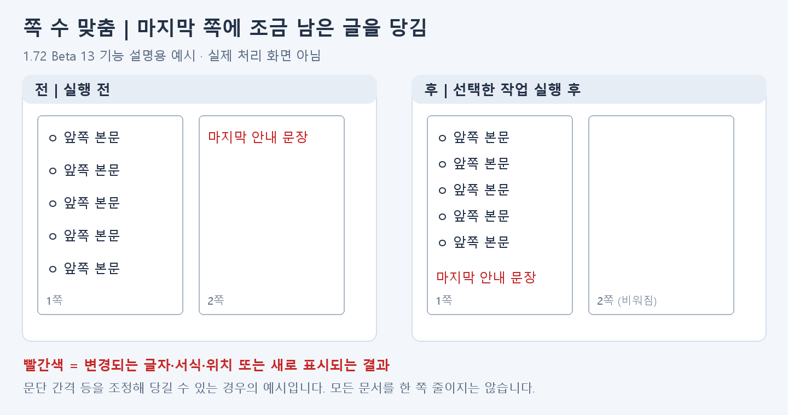](media/features/page-fit.png)

**한 번에 적용 → 페이지 맞춤 제외: 끔**, 세부 작업의 **문단 아래 간격 페이지 맞춤**을 확인하세요. 서식 통일의 원본 쪽 구성 유지와는 목표가 다릅니다.

### 5. 관련 문단 쪽 배치 — 제목·본문·표를 함께 읽도록

쪽 끝에 제목만 남거나 표의 설명과 표가 다른 쪽으로 갈라진 경우, **관련 문단을 당기거나 다음 쪽으로 옮겨 함께 배치**합니다. 중제목·소제목·첫 본문, 표와 딸린 주석 등을 고려합니다. 한 쪽보다 긴 묶음은 나뉠 수 있습니다.

[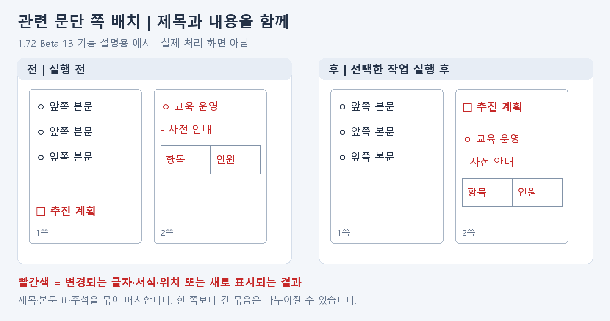](media/features/page-group.png)

**한 번에 적용 → 세부 작업 → 관련 문단 페이지 배치**에서 선택합니다. 쪽 수를 줄이는 **쪽 수 맞춤**과 함께 켜거나 별도로 선택할 수 있습니다.

### 6. 서식 통일 — 같은 역할의 문장끼리 다른 모양을 교정

`□`는 `□`끼리, `ㅇ`는 `ㅇ`끼리 비교해 글꼴·크기·색·정렬 등의 차이를 교정합니다. 문서 안의 대표값이 기준이며, **기관의 등록 서식을 적용하려면 한 번에 적용**을 선택합니다. 대표값을 확정하기 어려운 부분은 확인 대상으로 남길 수 있습니다.

[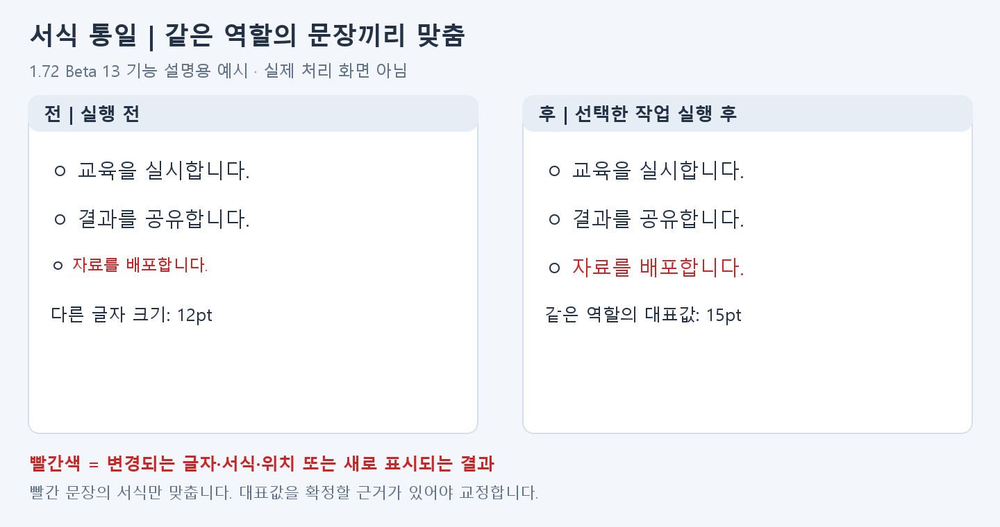](media/features/style-unify.png)

### 7. 짧은 마지막 줄 당기기 — 몇 글자만 남은 줄을 줄임

항목기호 문장의 마지막 줄이 **설정한 기준 글자 수 이하**이면 앞줄 자간을 줄여 병합을 시도합니다. “5글자 미만”으로 쓰려면 기준을 **4글자**로 설정하세요. 자간 조정 한도나 문단 구조에 따라 합쳐지지 않을 수 있습니다.

[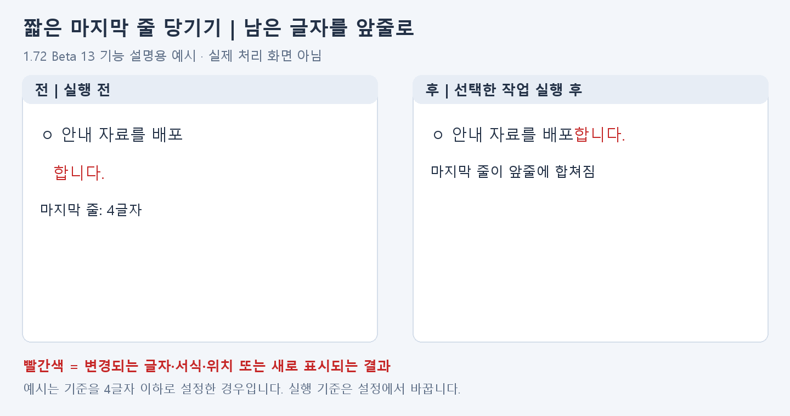](media/features/short-line.png)

**자간 정리 또는 한 번에 적용 → 세부 작업 → 짧은 마지막 줄 병합**에서 선택하고, 설정에서 기준 글자 수를 확인합니다.

## 필요한 곳부터 읽으세요

- [처음 설치하기](#install)
- [주요 기능의 빨간색 전·후 비교](#어떤-결과가-나오나요)
- [첫 문서 정리하기](#quick-start)
- [실제 예제로 따라 하기 — 영상·전후 비교](#examples)
- [세 가지 작업 중 고르기](#choose-mode)
- [주석·공백·라벨·표의 세부 기능 비교](#details-effects)
- [우리 기관의 예시 서식 등록하기](#formats)
- [결과 파일과 검사 결과 확인하기](#results)
- [문제가 생겼을 때](#help)
- [추가 기능과 지원 파일](#more)
- [개발자용 실행·빌드 안내](DEVELOPMENT.md)

## 1. 처음 설치하기

### 준비할 것

| 항목 | 필요한 내용 |
|---|---|
| 컴퓨터 | Windows 10·11, 64비트 |
| 한글 프로그램 | 문서를 편집할 수 있는 한컴오피스 한/글 설치. 주 검증 환경은 **한/글 2020**입니다. |
| 문서 | 처음에는 HWP 또는 HWPX 문서 한 개로 시작하세요. |
| 설치 권한 | 기관 PC는 프로그램 실행·한/글 자동화 허용 여부를 전산 담당자에게 확인하세요. |

한/글 뷰어만 설치된 PC나 Mac에서는 문서 자동 편집을 사용할 수 없습니다.
NEO·다른 한/글 버전은 설치 환경에 따라 차이가 있으므로 사본으로 먼저 확인하세요.

### 실행 파일로 시작하기 — 일반 사용자

1. [최신 실행 파일](https://github.com/haijun93/hwp-auto-docfit/releases/latest/download/HWP_AutoDocFit.exe)을 내려받아 보관할 폴더에 두고 두 번 클릭합니다.
2. 앱이 열리면 아래의 **첫 문서 정리하기**를 따라 합니다.

**실행 파일 사용에는 Python 설치나 명령어 입력이 필요하지 않습니다.**
HWP·HWPX의 기본 편집과 변환에 Node.js를 별도로 설치할 필요는 없습니다.

> Windows나 기관 보안 프로그램이 실행을 막으면 출처와 기관 정책부터 확인하세요. 보안 기능을 끄거나 무조건 실행을 허용하지 마세요.

## 2. 첫 문서 정리하기

먼저 작업 중인 한글 문서를 저장하고, 중요한 문서는 별도로 백업하세요. 이후에는 아래 네 단계만 따라 하면 됩니다. 배포 화면에 따라 버튼 이름은 조금 다를 수 있습니다.

| ① 문서 넣기 | ② 작업 고르기 | ③ 실행하기 | ④ 결과 보기 |
|---|---|---|---|
| **문서 선택 → 문서 추가**. 파일을 끌어 놓아도 됩니다. | **작업 방식**에서 카드 한 개를 선택합니다. | **정리 시작**을 누르고 기다립니다. | **결과 파일 열기**로 원본과 비교합니다. |
| 처음에는 예제 한 개만 | 줄 끝만: **자간 정리** / 보고서 양식까지: **한 번에 적용** | 한/글 작업 창을 편집하거나 닫지 마세요. | 글·표·쪽 나눔을 확인하세요. |

예를 들어 `업무보고.hwp`에 자간 정리를 실행하면 같은 폴더에 `업무보고(자간조정).hwpx`가 생깁니다.
익숙해진 뒤에는 여러 문서나 폴더를 한꺼번에 추가할 수 있습니다.

**여러 문서·쪽 범위 작업**: 파일·폴더를 추가해 차례로 처리하거나 작업할 쪽 범위를 지정할 수 있습니다. 쪽 범위 작업에서는 준말·표 변환 등 일부 구조 변경을 건너뜁니다.

[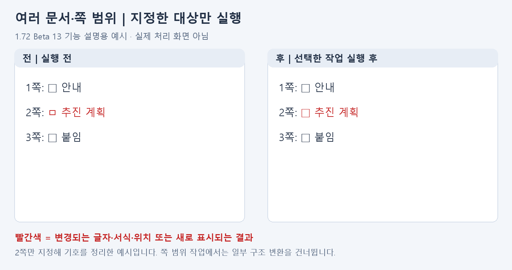](media/features/range.png)

### 실제 예제로 따라 하기: 보고서 예시 파일(한번에 적용).txt

`보고서 예시 파일(한번에 적용).txt`를 준비해 저장하세요. 삼체 문명을 소재로 한 가상 보고서이며 실제 행정문서가 아닙니다. 아래 두 실습은 **같은 TXT에서 각각 시작**합니다.

**예제 1(자간 정리)부터** 해 보세요. 줄 끝만 고치는 가장 기본 기능입니다. **보고서 모양까지 바꾸려면 예제 2(한 번에 적용)**입니다. TXT에는 원래 서식이 없으므로 비교 이미지의 ‘전’은 앱이 한글 문서로 변환한 직후입니다.

#### 예제 1. 줄 끝에서 갈라진 단어만 정리하기

먼저 아래 이미지의 개요 문장을 보세요. 위에서는 `거점(지 / 구)`, `수 / 립하여`가 두 줄로 갈라지고, 아래에서는 각각 한 줄에 모입니다.

이전 버전의 **실제 처리 결과**는 [거점(지구)·수립하여 전후 이미지](media/samchein/spacing-comparison.png)에서 확인하세요. 이 실습의 실측값과 영상은 1.69 Beta 18 기준입니다.

1. **문서 추가**에서 준비한 `보고서 예시 파일(한번에 적용).txt`를 선택합니다.
2. **자간 정리**를 고릅니다. **기존 자간 초기화: 켬**, **표 제외: 끔**으로 둡니다.
3. **정리 시작**을 누르고 결과 `보고서 예시 파일(한번에 적용)(자간조정).hwpx`를 엽니다.
4. 첫 개요 문장의 **거점(지구)**와 **수립하여**가 줄 끝에서 나뉘지 않는지 확인합니다. 이 예시에서는 각각 -3%, -2% 자간으로 앞줄에 모였습니다. 제목·표를 보고서 양식으로 바꾸지는 않습니다.

**[▶ 자간 정리 영상 보기 — 24초](media/samchein/spacing-guide.mp4)**

여기서 움직이는 안내 보기 — GIF 펼치기

움직이는 화면이 불편하면 접고 위의 정지 이미지와 번호 순서를 이용하세요.

#### 예제 2. 텍스트 초안을 보고서 모양으로 정리하기

README 맨 위의 전후 비교처럼 바꾸는 실습입니다. 아래 안내 이미지에서 **선택할 서식과 옵션**을 확인하세요. 실제 앱 화면이 아닌 설명용 이미지입니다.

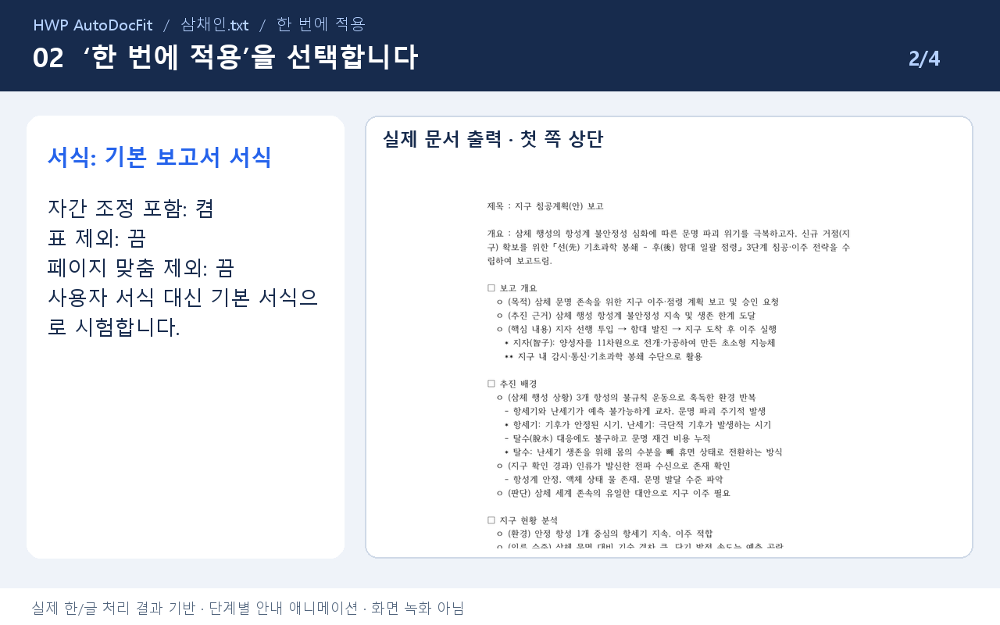

1. 목록에서 앞 실습 파일을 빼고 **원문 `보고서 예시 파일(한번에 적용).txt`를 다시 추가**합니다. 자간 정리 결과 파일을 넣는 실습이 아닙니다.
2. **한 번에 적용**을 고르고 **기본 보고서 서식**을 선택합니다.
3. **자간 조정 포함: 켬**, **표 제외: 끔**, **페이지 맞춤 제외: 끔**을 확인하고 **정리 시작**을 누릅니다.
4. `보고서 예시 파일(한번에 적용)(일괄적용).hwpx`에서 제목·개요 표, `□`·`ㅇ`·`-` 문장, ‘침공계획 개요’의 표를 확인합니다. 박스 문자로 그린 표가 편집 가능한 실제 표로 바뀝니다.

**[▶ 한 번에 적용 영상 보기 — 24초](media/samchein/all-guide.mp4)** · [전후 비교 크게 보기](media/samchein/all-comparison.png)

여기서 움직이는 안내 보기 — GIF 펼치기

움직이는 화면이 불편하면 접고 위의 정지 이미지와 번호 순서를 이용하세요.

이번 실행은 자간 정리 **2쪽 → 2쪽**, 한 번에 적용 **2쪽 → 3쪽**이었습니다. 보고서 글자 크기와 간격을 입히므로 쪽 수가 늘 수도 있습니다. 제목 아래 날짜·담당자·전화번호는 기본 양식의 예시 값이므로 실제 제출 전에 고치세요.

> 자동 검수만으로 완벽한 결과를 보장하지 않습니다. 이 사례의 최종 판정도 ‘부분 달성’입니다. [전체 결과 이미지·검수 한계·재현 방법](examples/samchein/README.md)을 함께 확인하세요.

## 3. 기본 문서 정리 작업 중 무엇을 고를까요?

| 원하는 일 | 고를 작업 | 기준 |
|---|---|---|
| 줄 끝에서 갈라진 단어, 마지막 줄의 짧은 글자를 정리하고 싶어요. | **자간 정리** | 현재 문서의 줄 배치 |
| 여러 사람이 쓴 문서에서 유독 다른 글꼴·크기 등을 맞추고 싶어요. | **서식 통일** | 같은 역할의 문장들이 많이 사용한 서식 |
| 정해진 보고서 양식으로 바꾸고 마무리까지 하고 싶어요. | **한 번에 적용** | 기본 서식 또는 내가 등록한 예시 서식 |

### 파일 변환

문서를 추가하고 **파일 변환** 카드를 고르면 결과 형식을 고르는 둥근 메뉴가 열립니다. HWPX·PDF·DOCX·EPUB·HTML·JPG·PNG·TXT·MD 중 하나를 누르면 **그 즉시 변환을 시작**합니다. 가운데 취소·Esc·창 바깥 클릭은 아무것도 바꾸지 않습니다. 모든 경로에서 원본을 덮어쓰지 않습니다.

| 변환 | 쓰는 도구 | 추가 설치 |
|---|---|---|
| HWP → HWPX | 한/글 내장 저장 | 없음(한/글만 있으면 됨) |
| HWP·HWPX → PDF·JPG·PNG | 한/글 내장 저장 | 없음(한/글만 있으면 됨) |
| TXT·MD → HWPX | EXE 내장 변환 엔진 | 없음 |
| TXT·MD → PDF·JPG·PNG | 내장 엔진 + 한/글 저장 | 없음(한/글 필요) |
| PNG·JPG·WEBP·BMP·TIFF·GIF → HWPX | 내장 kordoc + 한국어 OCR | 없음 |
| 이미지 → PDF·JPG·PNG | 내장 OCR + 한/글 저장 | 없음(한/글 필요) |
| HWPX → TXT·MD | 내장 HWPX 분석기 | 없음 |
| PDF·DOCX·PPTX·XLSX → HWPX | EXE 내장 변환 엔진 | 없음 |
| PDF → PDF 압축 | EXE 내장 pypdf·Pillow(그림 150dpi·품질 75로 다시 저장) | 없음(한/글 불필요) |
| → DOCX·EPUB·HTML | EXE 내장 kordoc + Pandoc | 없음(오프라인 내장) |

**PDF 압축**은 넣은 파일이 모두 PDF일 때만 켜집니다. 결과는 `원본(PDF압축).pdf`로 저장되고 원본은 그대로입니다.
- 스캔본·사진이 많은 PDF에서 효과가 큽니다. 한/글로 만든 글자 위주 PDF는 5% 미만으로 줄면 "이미 충분히 작아 줄이지 않았습니다"라고 알리고 파일을 만들지 않습니다.
- 쪽 수·쪽 크기·쪽마다의 글자가 원본과 다르면 결과를 버립니다.
- 인쇄·복사 제한이 걸린 보안 PDF는 결과도 같은 권한으로 잠깁니다(보호가 풀린 사본을 만들지 않음). 열기 암호 PDF, 문서보안(DRM) 파일, 전자서명 PDF는 줄이지 않습니다.

도구가 없는 형식은 메뉴에서 흐리게 표시되고 이유를 알려 줍니다. 재생성 경로는 표·글꼴·쪽 배치가 원본과 다를 수 있고, 글자층이 없는 PDF·그림은 글자 인식(OCR) 품질에 따라 결과가 달라지므로 꼭 확인하세요.
HWP·HWPX → PDF를 한/글 대신 독자 조판 엔진(rhwp)으로 만드는 방식도 비교했지만, 실제 문서 7종 중 2종이 실패하고 1종은 쪽 구성이 달라져 한/글 방식을 유지합니다([비교 기록](PDF_ENGINE_BENCHMARK_2026-10-16.md)).

**자간**은 글자 사이 간격, **서식**은 글꼴·크기·색·문단 간격·표 모양 등을 뜻합니다.
**내어쓰기**는 둘째 줄부터의 시작 위치를 맞추는 방식입니다. 기본 기준은 괄호 라벨이면 항목기호 뒤 `(`, 콜론 라벨이면 콜론 뒤 본문 첫 글자입니다.

처음에는 위 실습의 옵션으로 시작하세요. 아래 설명은 결과를 조절하고 싶을 때만 펼쳐 읽으면 됩니다.

세 가지 문서 정리 작업의 옵션과 차이 자세히 보기

### 자간 정리

갈라진 단어를 한 줄로 모으고 짧게 남은 마지막 줄을 줄이도록 시도합니다.
안전 한도 안에서 조정하며, 모든 줄을 반드시 맞추는 기능은 아닙니다.

- **기존 자간 초기화**: 이전 자간을 0%로 되돌린 뒤 정리합니다. 기존 조정값을 출발점으로 쓰려면 끄세요. 꺼도 이후 자간 정리는 실행됩니다.

[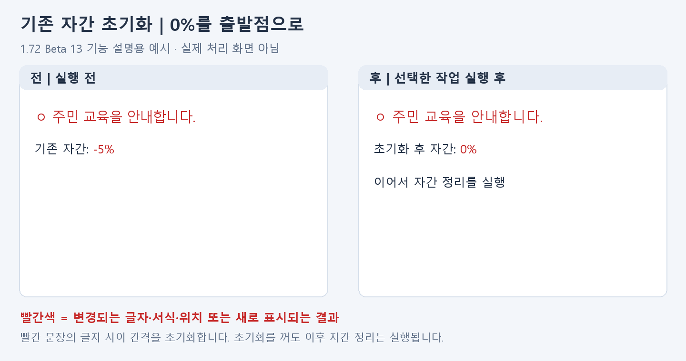](media/features/reset-spacing.png)

- **표 제외**: 표 칸 안 문장을 자간 정리 대상에서 뺍니다.

  자간 정리에서는 한 칸짜리 개요 표도 제외합니다. 줄에 맞추기 위해 연결선 부호를 삭제하지 않습니다. 공문 규정에 따른 날짜·붙임·끝 표시의 공백 보정은 별도로 적용합니다.

[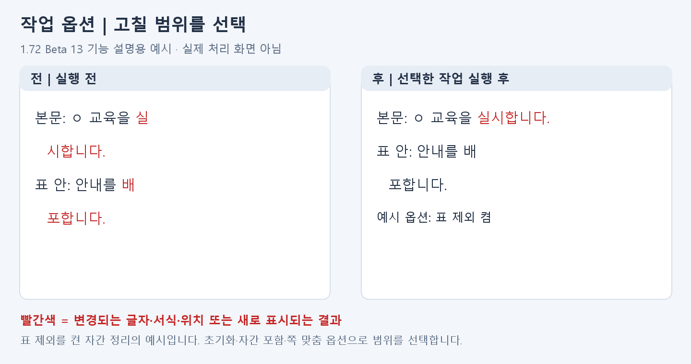](media/features/options.png)

### 서식 통일

문서 전체를 한 가지 글꼴로 만드는 기능이 아닙니다. `□` 제목은 `□`끼리, `ㅇ` 문장은 `ㅇ`끼리처럼 **같은 역할끼리 비교**합니다.

예를 들어 `ㅇ` 문장 20개 중 18개가 한컴돋움 15pt이고 2개만 굴림 12pt라면, 다른 2개를 교정 대상으로 삼습니다.
글꼴·크기뿐 아니라 색·기울임·밑줄·정렬·여백 등도 비교하며, 대표값이 불확실한 경우는 확인 대상으로 남길 수 있습니다.

- **표 제외**: 기본 표 서식과 표 서식통일을 뺍니다. 본문만 맞추고 싶을 때 켜세요.
- **자간 정리 제외**: 서식을 고친 문장의 자간 정리·짧은 줄 당기기를 하지 않습니다. 내어쓰기는 별도로 맞춥니다.
- **페이지 맞춤 제외**: 일반 쪽 수 맞춤을 제외합니다. 서식 통일에서는 기본으로 켜져 있습니다. 다만 아래 **원본 쪽 구성 유지**를 켜면 원본 구성을 맞추기 위한 보정은 실행됩니다.
- **원본 쪽 구성 유지**: HWP·HWPX의 원본 전체 쪽 수와 보고서별 쪽 구성을 기준으로 보정합니다(기본 켬). TXT 등 원본 쪽 구성이 없는 입력은 기준으로 삼지 않습니다. 완전히 같은 줄바꿈까지 보장하는 옵션은 아니며 검수 결과를 확인하세요.

[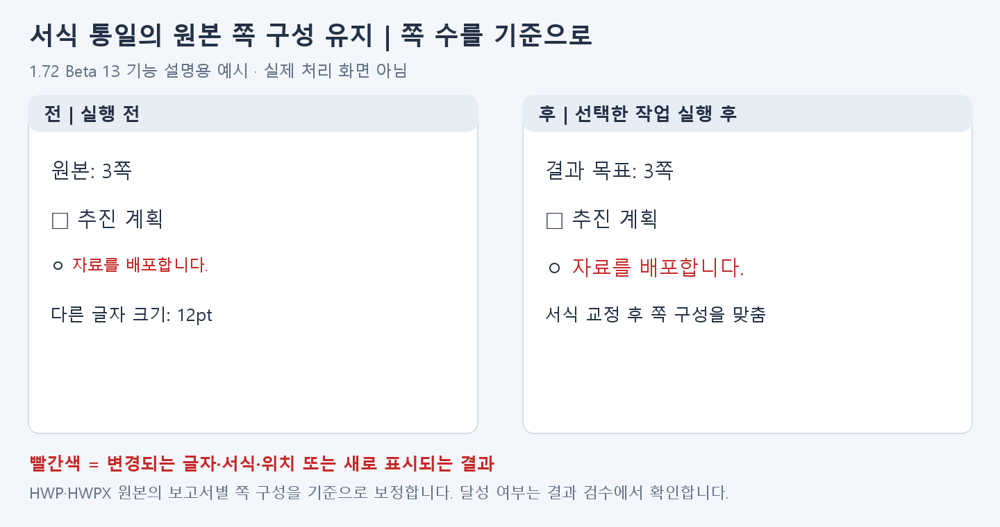](media/features/original-layout.png)

**자간 정리 제외**의 효과는 위 [자간 정리 비교](media/features/spacing.png), 일반 **쪽 맞춤 제외**의 효과는 [쪽 수 맞춤 비교](media/features/page-fit.png)의 빨간 변화가 생략되는 것으로 확인할 수 있습니다. **표 제외**는 아래 표 서식 비교의 변경을 제외합니다.

본문의 정상 문장은 서식 교정을 건너뛰지만, 켜 둔 표 작업이나 배치 작업은 별도로 실행될 수 있습니다.

### 한 번에 적용

**서식 기준**에서 기본 서식이나 저장한 사용자 서식을 고릅니다.
준말 변환, 보고서 서식, 제목·개요·표 정리와 자간 등의 선택된 작업을 순서대로 실행합니다.

- **줄 간격 적용**: 켜면(기본) 서식의 줄 간격을 입히고, 끄면 문서의 줄 간격을 그대로 둡니다. 쪽 맞춤 때의 줄 간격 조정은 **페이지 맞춤 제외**로 따로 끕니다.
- **자간 조정 포함**: 끄면 예전의 **서식 적용** 방식으로 실행합니다. 전체 자간 정리 단계는 빠지지만, 예시 서식의 자간값 적용이나 **개요·한 칸 표 자간 조정** 등은 별도입니다. 자간이 전혀 변하지 않는다는 뜻은 아닙니다.
- **표 제외**: 일반 표 관련 작업을 뺍니다. **제목·개요·중제목·붙임 서식 표는 별도 대상**이므로 함께 제외되지 않습니다.
- **페이지 맞춤 제외**: 문단 간격을 줄여 쪽 수를 맞추거나 관련 문단을 같은 쪽에 모으는 작업을 뺍니다. 글꼴·크기 변경 자체로 생기는 줄바꿈까지 고정하지는 않습니다.

옵션 효과는 [자간 정리](media/features/spacing.png)·[표 서식](media/features/table-format.png)·[쪽 수 맞춤](media/features/page-fit.png)·[관련 문단 쪽 배치](media/features/page-group.png)의 전·후 비교에서 확인하세요. 제외하면 해당 비교의 빨간 변경을 위한 단계가 빠집니다.

카드 아래 **세부 작업**을 펼치면 실행할 단계를 분류(문서 서식·문장·기호·표·자간·줄 끝·쪽 배치)별 카드로 켜고 끌 수 있습니다. 카드를 가리키면 오른쪽에 그 단계의 **적용 전·후 모습을 한/글 조판 방식(rhwp)으로 그린 미리보기**가 나옵니다.
카드 옵션과 관련 세부 작업은 서로 연동되므로, 시작 전에 선택 상태를 확인하세요. **다음 실행에도 이 구성 사용**을 켜면 바꾼 구성이 저장됩니다.

기본 후처리의 세부 기능도 전·후 비교로 보기

### 부연설명·별표 주석 정렬

`*`·`**`·`※` 문장의 앞 빈칸을 부모 항목기호에 따른 기준으로 맞춥니다. `**`의 둘째 별표 위치도 함께 정리합니다. **부연설명 들여쓰기**를 선택하며, 사용자 서식은 별도 규칙을 따를 수 있습니다.

[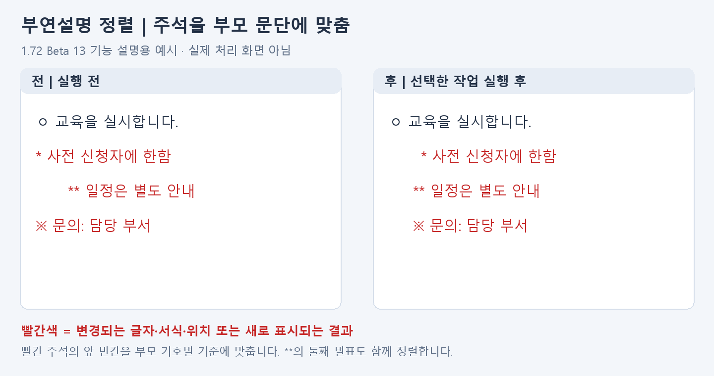](media/features/supplement.png)

### 공백·항목기호·날짜 표기 정리

선택한 규칙에 따라 `ㅁ → □`, 괄호 안쪽 불필요한 공백, 쉼표 뒤 공백과 공문 날짜 표기를 정리합니다. `붙임` 뒤·`끝.` 앞에 필요한 두 칸은 보존합니다. 날짜 뒤에 붙은 시각(`2026. 10. 4. 15:00`)은 날짜로 보지 않으며, 고정폭 빈칸처럼 화면에 보이지 않는 글자가 있는 문단은 실제 글자 위치를 맞춰 고치고, 위치를 맞출 수 없으면 고치지 않습니다(Beta 16). 그림의 빨간 `·`는 삭제되는 공백을 눈에 보이게 한 설명용 표시입니다.

[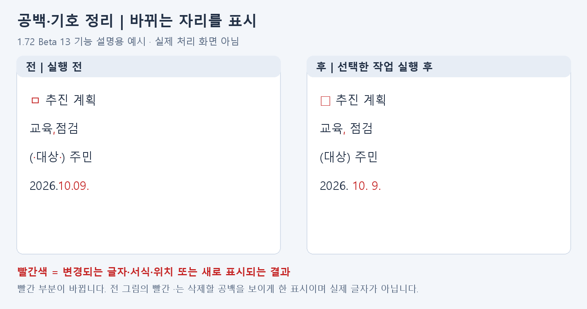](media/features/spacing-rules.png)

### 문두 라벨 강조·괄호 글자 축소

문두의 `(대상)` 같은 라벨을 강조하고 괄호 안 글자 크기를 설정에 따라 줄입니다. 항목기호별 제외와 사용자 서식 규칙을 적용할 수 있습니다.

[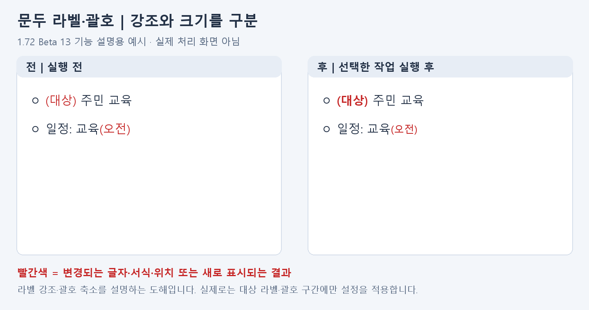](media/features/labels.png)

### 본문 별표 위첨자

단어 뒤의 `*`·`**`를 위첨자로 바꿔 본문 표시와 줄 앞 부연설명 기호를 구분합니다. **별표(*, **) 위첨자 적용**에서 선택합니다.

[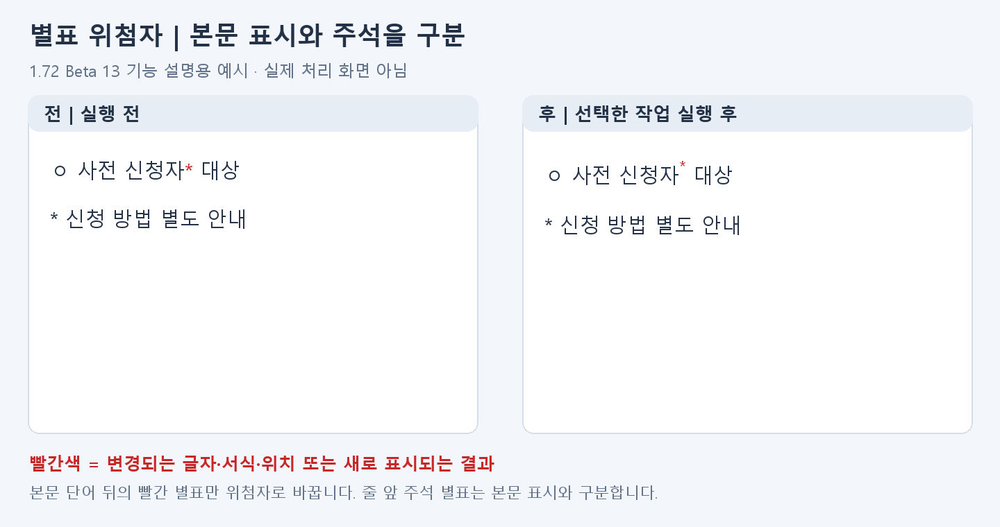](media/features/asterisk.png)

### 준말·라벨을 제목·개요·항목기호로

한 번에 적용의 **준말 → 본말 변환**은 줄 앞에 등록한 준말과 콜론이 있을 때 실행합니다. 텍스트 붙여넣기의 **라벨 입력**은 `제목1:`·`개요:`·`네모:`·`원:` 등을 표·기호로 바꿉니다. 제목·날짜·담당자 정보는 결과에서 확인하세요.

[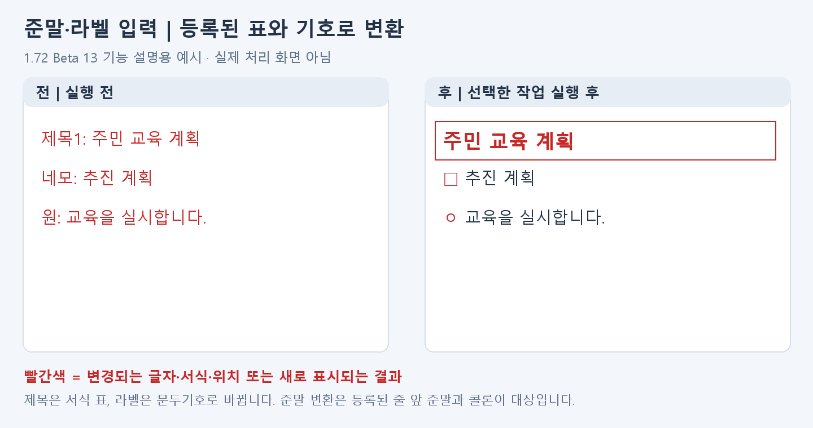](media/features/abbreviation.png)

### 박스 문자로 그린 표를 실제 표로

AI 답변 등에 들어 있는 `┌─┬─┐` 형태의 텍스트 표를 지원하는 구조에 한해 한/글에서 편집 가능한 실제 표로 변환합니다. **텍스트 표(박스 그림)를 실제 표로 변환**에서 선택합니다.

[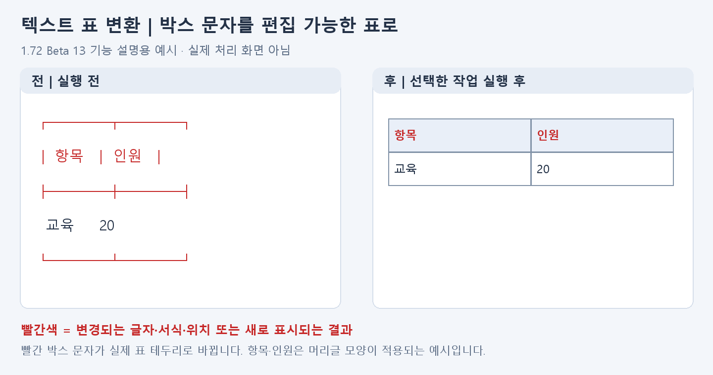](media/features/table-convert.png)

### 표 머리글·본문 서식

일반 표의 머리글·본문을 역할별로 구분해 글자·문단·테두리·배경 등의 서식을 적용합니다. 제목·개요·중제목·붙임 표는 종류별 서식을 따릅니다. 서식 통일에서는 같은 종류의 표끼리 비교합니다.

[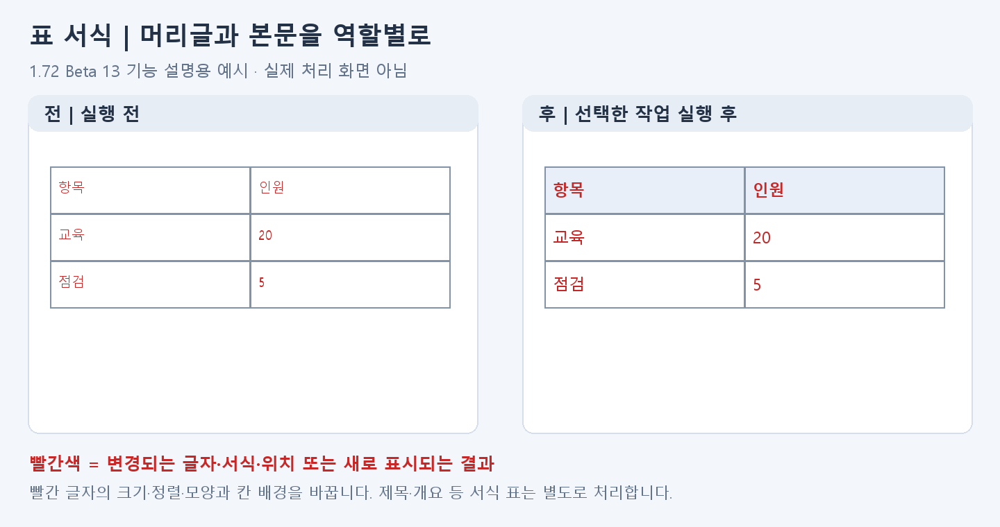](media/features/table-format.png)

### 표 칸 너비 맞춤

일반 표의 열 너비를 칸 글자 수와 최소 폭을 고려해 배분하고, 전체 표 폭을 쪽 좌우 여백 사이에 맞춥니다. 중제목의 글 칸은 별도 규칙으로 맞춥니다. **표 칸 너비**에서 선택합니다.

표 칸 안에 날짜(`’26. 10. 10.(토)`, `2026. 10. 10.`, `10. 6.(화) 14:00` 등)가 주로 들어 있으면 그 칸은 **한 줄로 입력**으로 두어, 칸 폭이 좁아도 날짜가 두 줄로 나뉘지 않습니다(제목 서식 표의 날짜 칸 포함, Beta 15).

[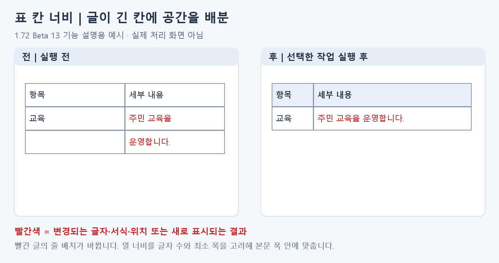](media/features/table-width.png)

## 4. 우리 기관의 예시 서식 등록하기

**예시 문서**는 모양을 배울 문서이고, **정리할 문서**는 그 모양을 적용할 문서입니다.
내용이 다른 두 문서를 각각 준비해도 됩니다.

[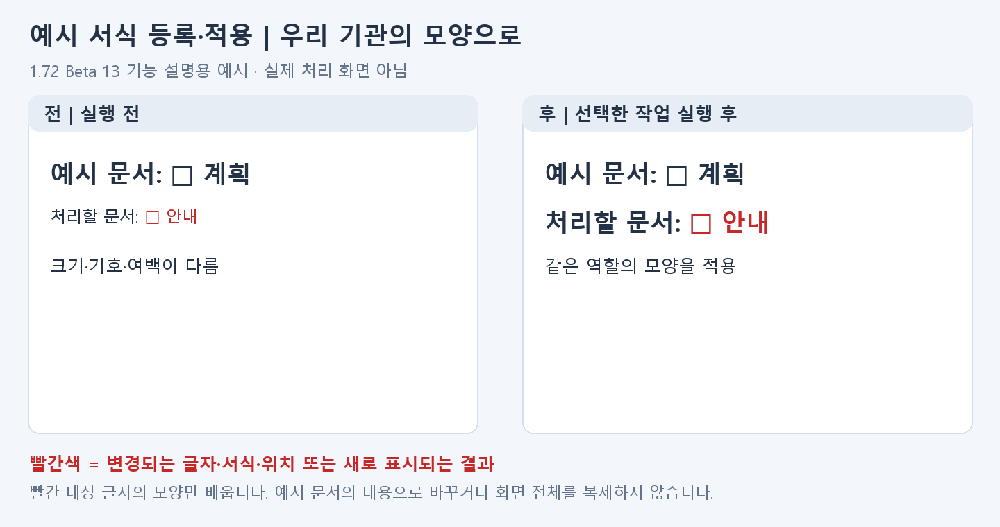](media/features/format-copy.png)

1. **작업 방식 → 서식 관리**를 엽니다.
2. **파일에서 고르기**로 예시 HWP·HWPX 문서를 선택하거나, 서식 관리 창에 끌어다 놓습니다.
3. 분석 뒤 열리는 **서식 세부사항**에서 **서식 이름·기관명·대표값**을 확인하고 수정합니다.
4. 저장하면 서식 목록에 추가됩니다. 해당 서식의 **사용**을 눌러 선택합니다.
5. 서식 관리 창을 닫고 **정리할 문서**를 추가한 뒤 **한 번에 적용**을 실행합니다.

> 서식 관리 창에 파일을 놓으면 **처리할 문서 추가가 아니라 서식 등록**으로 동작합니다.

등록할 때 확인할 서식 요소와 수정 기능

| 영역 | 분석·확인하는 주요 항목 |
|---|---|
| 항목기호 문장 | 기호·계층별 글꼴, 크기, 굵게, 색, 자간·장평, 정렬, 여백, 줄·문단 간격 |
| 제목 표 | A1·A2·B2 등 칸별 글자·문단 모양, 테두리, 배경, 안쪽 여백, 세로 정렬 |
| 개요·중제목·붙임 표 | 표 종류별·칸별 서식과 대표값 |
| 일반 표·쪽 설정 | 표의 역할별 서식과 쪽 여백 등 |

칸 이름의 **A·B는 열**, **1·2는 행**입니다. 예를 들어 **B2는 두 번째 열의 두 번째 행**입니다.
병합된 표는 칸 구성이 다를 수 있습니다.

분석 화면에서는 대표값뿐 아니라 표본 수와 다른 값도 확인할 수 있습니다.
**적용 방식**의 **값 복사 / 규칙 복사 / 표시만**을 구별하세요. 표시되는 모든 항목이 그대로 적용되는 것은 아닙니다.

- **세부 수정**: 저장된 서식의 값을 다시 고칩니다.
- **이름 바꾸기**: 목록에 보일 서식 이름과 기관을 바꿉니다.
- **삭제**: 사용자 서식을 지웁니다. 기본 서식은 삭제할 수 없으며, 기본 서식 수정은 새 서식으로 저장합니다.
- **예시 직접 작성**: 참고 문서가 없을 때 한/글에서 예시를 작성해 등록합니다.

[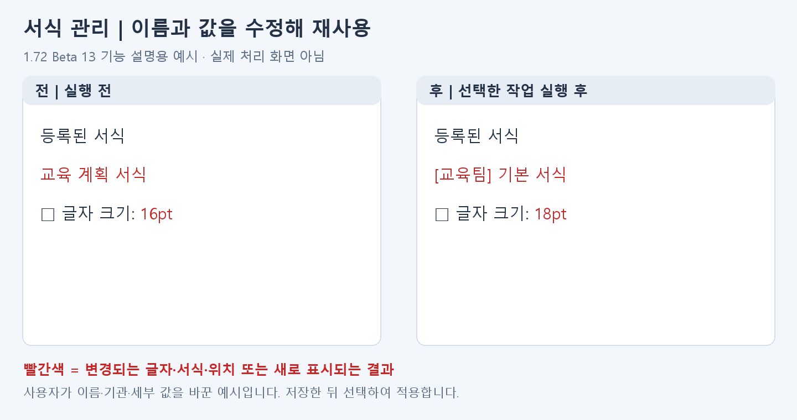](media/features/format-manage.png)

**서식 등록은 원본 문서의 완전 복제를 보장하지 않습니다.**
예시에 없는 표 종류는 내장 기준이 사용될 수 있고, 글의 길이·설치 글꼴·표 구조에 따라 줄바꿈과 쪽 수가 달라집니다.
용지 크기·방향은 자동으로 바꾸지 않으므로 다른 경우 처리 기록을 확인하세요.
자세한 범위는 [서식·표 상세 안내](ADVANCED_USAGE.md#format-details)를 참고하세요.

## 5. 결과는 어디에 저장되나요?

기본적으로 **원본 문서와 같은 폴더**에 저장됩니다. 입력이 HWP여도 결과는 HWPX입니다.

[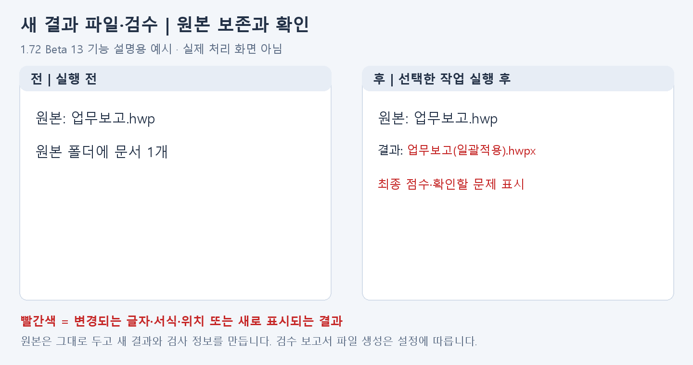](media/features/results.png)

### 예제 결과를 눈으로 확인하세요

아래는 ‘한 번에 적용’ 결과의 전체 3쪽입니다. **이미지를 누르면 크게 볼 수 있습니다.** 내 결과도 이런 순서로 확인하세요. 날짜·담당자 예시 값은 실제 값으로 바꿔야 합니다.

| 1쪽: 제목·개요·문단 | 2쪽: 표·추진계획 | 3쪽: 나머지 본문·붙임 |
|---|---|---|
| [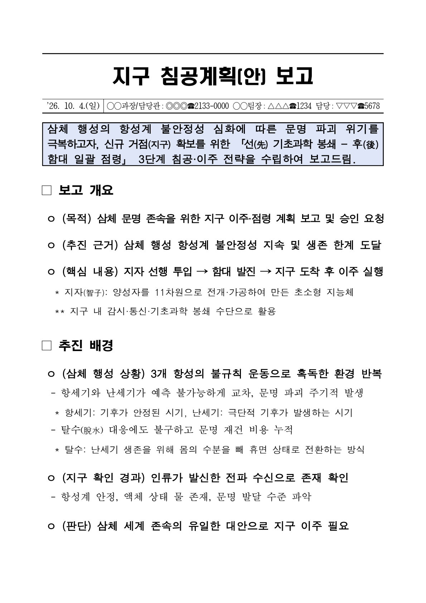](media/samchein/all-page-1.png) | [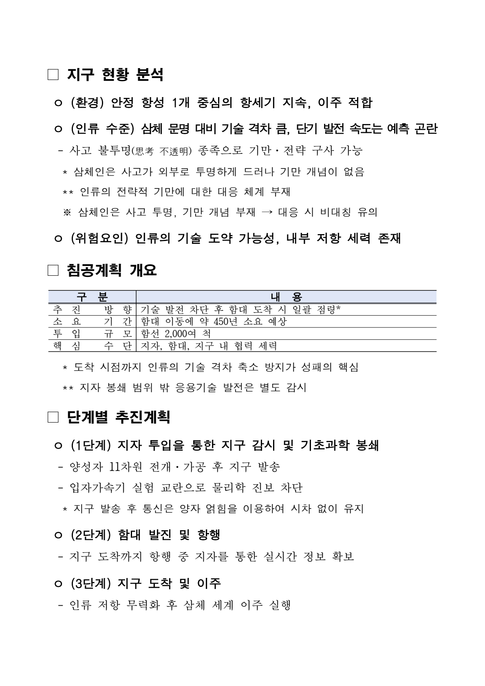](media/samchein/all-page-2.png) | [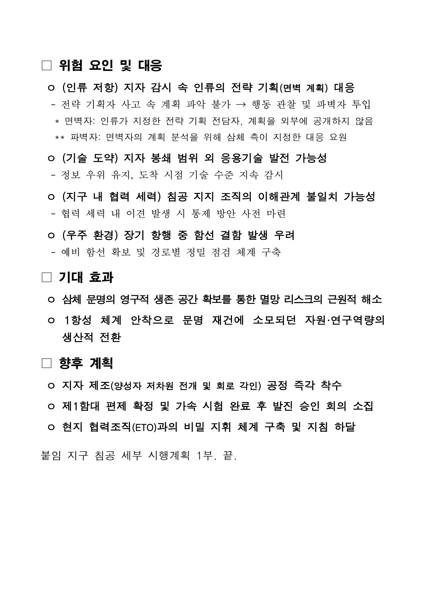](media/samchein/all-page-3.png) |
| 제목과 개요가 있는지 | 표의 글·숫자와 셀을 확인 | 마지막 문장까지 있는지 |

### 내 결과 파일 찾기

| 실행한 작업 | 결과 파일 예 |
|---|---|
| 자간 정리 | `업무보고(자간조정).hwpx` |
| 서식 통일 | `업무보고(서식통일).hwpx` |
| 한 번에 적용 — 자간 조정 포함 | `업무보고(일괄적용).hwpx` |
| 한 번에 적용 — 자간 조정 제외 | `업무보고(서식적용).hwpx` |

**제출 전에는 다음 세 가지를 확인하세요.**

- 글·숫자·표·그림이 빠지지 않았는지
- 제목·줄 끝 단어·둘째 줄 시작 위치가 자연스러운지
- 쪽 수, 표 잘림, 제목만 쪽 끝에 남는 문제가 없는지

처리 기록과 검사 보고서는 확인을 돕는 자료입니다. **자동 검사를 통과해도 문서가 완벽하다는 뜻은 아닙니다.**

처리 기록·검사 보고서 파일 알아보기

| 기록 | 확인할 내용 |
|---|---|
| 앱의 **처리 기록** | 실행 단계, 제외한 항목, 경고·오류 |
| `(최종검수).json` | 설정 → 기록에서 파일 생성을 켰을 때 작업 수행 결과와 확인할 문제를 저장합니다(기본 켜짐). 여러 문서는 첫 번째 입력 문서 폴더에 전체 작업 보고서를 저장합니다. |
| `(무결성검사).json` | 설정 → 문서에서 상세 진단·무결성검사를 켜고, 설정 → 기록에서 보고서 파일 생성을 켰을 때 저장합니다. |
| `(작업로그-날짜시간).log` | 설정 → 기록에서 작업로그 파일 생성을 켰을 때만 만듭니다. 기본은 꺼짐이며 첫 번째 입력 문서 폴더에 저장합니다. |
| `(무결성검사).json`, `(최종검수).json` | 설정 → 기록에서 해당 JSON 파일 만들기를 켰을 때만(기본값 꺼짐, 2026-10-10) |

파일을 남기지 않으려면 **설정 → 기록**에서 해당 파일 생성 체크를 끄세요. 보고서 파일 생성을 꺼도 최종 점수는 앱의 완료 화면과 처리 기록에 표시됩니다.

JSON은 검사 내용을 담은 텍스트 파일입니다. 처음에는 앱의 결과·처리 기록부터 확인해도 됩니다.

## 6. 문제가 생겼을 때

| 상황 | 먼저 확인할 것 |
|---|---|
| 실행 파일을 구하기 어려워요. | 기관의 실행 파일 반입 정책과 배포 담당자에게 문의하세요. 소스 ZIP은 실행 파일의 대체품이 아닙니다. |
| 앱은 열리지만 문서를 처리하지 못해요. | 한/글에서 해당 문서를 직접 열고 편집할 수 있는지 확인하세요. 뷰어만 설치됐거나 자동화가 차단된 환경일 수 있습니다. |
| **정리 시작**을 누를 수 없어요. | 처리할 문서가 목록에 있는지, 작업 방식을 골랐는지 확인하세요. |
| 처리가 멈춘 것 같아요. | 처리 기록과 한/글의 확인 창을 살펴보세요. 다른 문서를 저장하지 않은 채 한/글 프로세스를 강제 종료하지 마세요. |
| 서식을 골랐는데 적용되지 않아요. | **서식 통일**은 문서 자체가 기준입니다. 등록한 서식을 쓰려면 **한 번에 적용**을 선택하세요. |
| 표나 쪽 배치가 예상과 달라요. | **표 제외**, **페이지 맞춤 제외**, **세부 작업**을 확인하고 원본으로 다시 시험하세요. |
| 빨간 문장이 생겼어요. | 서식 통일에서 대표값을 확정하지 못한 표시일 수 있습니다. 처리 기록을 확인하고 해당 문장을 직접 검토하세요. |
| 업데이트 뒤 `Failed to load Python DLL` 창이 떠요. | Beta 13·14의 업데이트 기능에 있던 문제입니다(Beta 15에서 수정). 배포 담당자에게 받은 `HWP_AutoDocFit.exe`로 기존 파일과 바꾸면 다음 업데이트부터 정상입니다. |
| DOCX·PDF 변환에서 오류가 나요. | HWP → HWPX와 HWP·HWPX → PDF·그림은 한/글만 있으면 됩니다. 외부 형식 변환 엔진과 Pandoc은 EXE에 포함됩니다. [폐쇄망 배포 안내](OFFLINE_DEPLOYMENT.md)를 확인하세요. |
| 결과가 마음에 들지 않아요. | 원본은 그대로 있습니다. 기존 결과를 보관하려면 다른 이름으로 복사한 뒤, 원본을 대상으로 옵션을 줄여 다시 실행하세요. |

해결되지 않으면 [GitHub 이슈](https://github.com/haijun93/hwp-auto-docfit/issues) 또는 [GitLab 이슈](https://gitlab.aigov.go.kr/haijun93/hwp_autodocfit/-/issues)에 다음 정보를 남겨 주세요.

- 앱 버전과 한/글 버전
- 선택한 작업·옵션, 파일 형식
- 오류 메시지와 재현 순서

**개인정보·비공개 업무 문서·민감한 내용이 든 로그를 공개 게시판에 올리지 마세요.**
예시 파일이 필요하면 내용을 가린 사본이나 같은 문제가 생기는 새 문서를 사용하세요.

## 7. 익숙해지면 써 볼 기능

각 이미지의 빨간 글자는 바뀌는 부분 또는 새로 표시되는 결과입니다. 이미지를 누르면 크게 볼 수 있습니다.

텍스트 붙여넣기·정리 — 전·후 비교 펼치기

파일 없이 글을 입력해 문서 목록에 추가합니다. 선택한 옵션에 따라 Markdown 표시 정리, 라벨 해석, 개조식 변환을 실행합니다.

[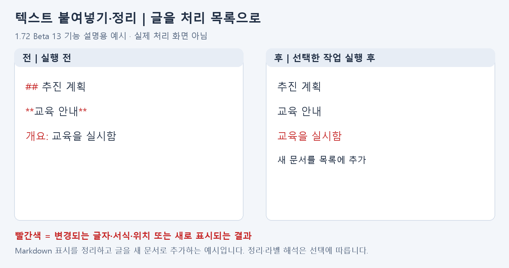](media/features/input.png)

아웃라이너로 작성 — 전·후 비교 펼치기

Tab·Shift+Tab으로 항목의 상하 관계를 정하며 작성합니다. 계층을 바꾸면 항목기호와 들여쓰기 위치가 함께 바뀝니다.

[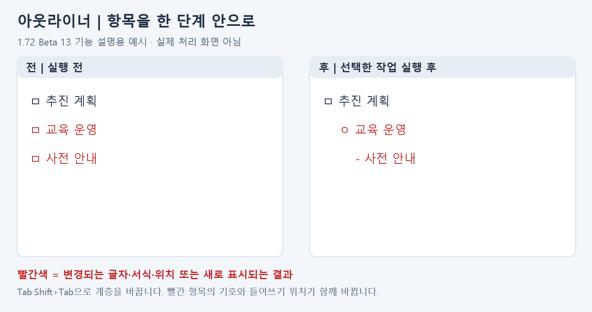](media/features/outliner.png)

작성 도우미 — 전·후 비교 펼치기

금액 한글 병기, 날짜·요일, 표 계산, 번호 정리 등의 도구를 선택해 사용합니다. 사용자가 선택한 도구의 결과를 확인하여 활용합니다.

[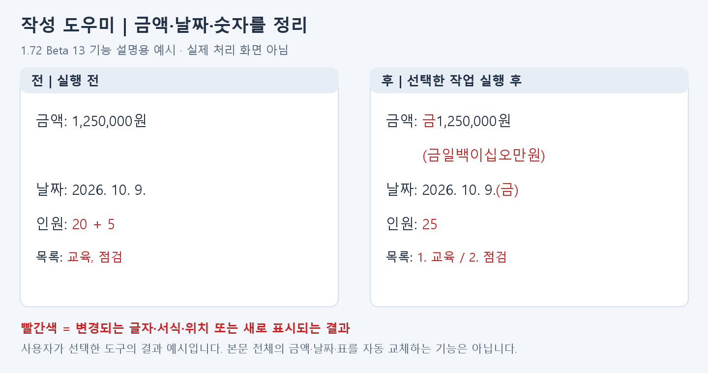](media/features/writing.png)

문서 구조·가독성 검토 — 전·후 비교 펼치기

구조와 서식 차이를 읽기 전용으로 점검합니다. 원문을 바꾸지 않고 검토할 후보를 표시합니다.

[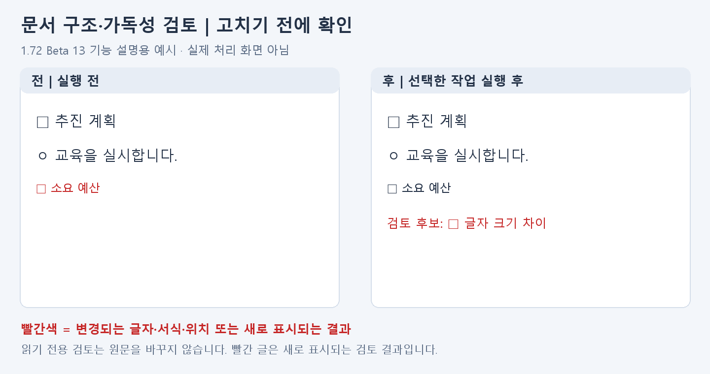](media/features/review.png)

공공언어·맞춤법 검토 — 전·후 비교 펼치기

내장 규칙이 찾은 후보를 검토하고 승인한 교정만 새 파일로 저장합니다.

[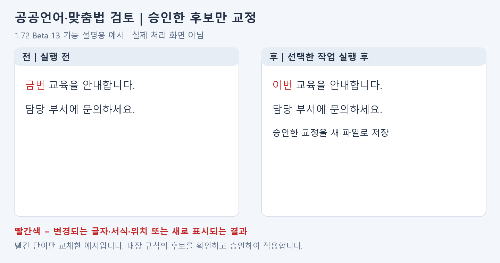](media/features/proofread.png)

Markdown 내보내기 — 전·후 비교 펼치기

본문과 표를 다른 도구에서 쓸 수 있는 새 텍스트 파일로 내보냅니다. 원본 한글 문서는 그대로 둡니다.

[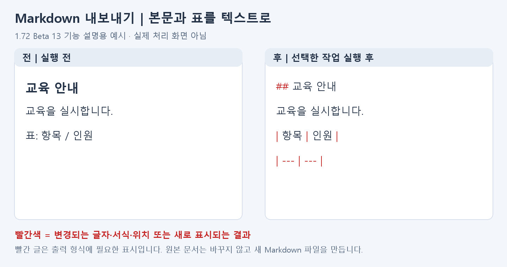](media/features/markdown.png)

표/다이어그램 만들기 펼치기

상단의 **표/다이어그램** 버튼으로 엽니다. 표는 **표 복사 (한/글 붙여넣기)**, 다이어그램·마인드맵은 **그림 복사 (한/글 붙여넣기)**를 누른 뒤 한/글 2020에서 **Ctrl+V**로 붙입니다. 표의 HWPX 저장과 도형의 PNG 저장도 지원합니다.

Windows 빌드·실행 창 버전 검사 및 공개 배포 파일 해시 검증은 통과했습니다. 실제 한/글 문서의 붙여넣기·조판 검수는 별도 확인이 필요하며, HTML 표의 세부 모양은 한/글 해석에 따라 달라질 수 있습니다.

| 탭 | 할 수 있는 일 |
|---|---|
| 다이어그램 | PPT처럼 사각형·원·화살표·순서도 기호 등 40여 가지 도형과 선을 놓고 연결합니다. 선 종류(실선·점선)·화살표 머리 모양, 도형 테두리색·바탕색을 고릅니다. 시작 서식은 가로·세로 두 가지입니다. |
| 마인드맵 | 가운데 주제에서 가지를 더하고 옮깁니다. 가지마다 PPT 도형 모양을 고를 수 있습니다. |
| 흐름표 | 학습한 추진일정 흐름표 모양으로 2~6칸을 만들고 자유롭게 늘립니다. 세로 방향 확장과 칸 사이 화살표 모양을 고릅니다. |
| 기본 표 | 행·열을 늘리고 줄이며 머리글 색, 한/글과 같은 테두리 종류(실선·점선·2중선·투명선 등 12종)·굵기를 칸별로 고릅니다. |
| 조직표·장식표 | 조직도와 장식 막대 표를 만듭니다. 이렇게 만든 표는 서식 작업이 손대지 않습니다. |

글꼴·크기·굵게·색은 이 PC에 설치된 한/글 글꼴에서 고릅니다.

설정 — 상용구 관리와 한/글 조판 미리보기 펼치기

- **전체 설정 열기**: 분류별 카드에서 설정을 바꾸면 오른쪽 **한/글 조판 미리보기**가 바로 다시 그려집니다. 바꾼 설정이 닿는 문단은 노랗게 표시하고, **크게 보기**로 넓게 볼 수 있습니다.
- **글자 상용구·본문 상용구**: 한/글의 상용구를 앱에서 추가·수정·삭제합니다. 한/글이 쓰는 파일을 바로 고치며, 고치기 전 파일을 매번 백업합니다. 한/글이 켜져 있으면 한/글을 닫을 때 한/글이 자기 파일로 덮어쓸 수 있으니 한/글을 닫고 고치세요.
- **글꼴**: 한/글 글꼴 폴더를 자동으로 찾아, 글꼴 칸에서 **이 PC 글꼴에서 고르기**로 고릅니다.
- **앱 정보**: 버전과 개발자(도토리만두)를 표시합니다.

기능 위치와 자세한 예시는 [추가 기능 안내](ADVANCED_USAGE.md)를 참고하세요.
서식 편집은 내용의 사실관계나 모든 맞춤법 오류까지 확인하는 기능이 아닙니다.

### 지원 파일과 추가 설치

- **HWP·HWPX**: 기본 대상입니다. 한/글 설치가 필요합니다.
- **TXT·MD**: 한/글 문서로 변환해 처리합니다. AI 답변을 복사한 글과 Markdown 제목(#)·표는 개조식 항목기호와 실제 표로 바꿉니다.
- **DOC·DOCX·PPTX·XLSX·PDF·그림**: EXE에 포함된 변환 엔진으로 처리합니다. 별도 런타임 ZIP 다운로드는 필요하지 않습니다.
- **PDF·스캔 문서**: 원래 편집 구조나 서식이 완전히 복구되는 것은 아닙니다. OCR·변환 결과를 확인하세요.

엔진 설치와 제한사항은 [고급 문서 도구](ADVANCED_USAGE.md#engine)와 [폐쇄망 배포 안내](OFFLINE_DEPLOYMENT.md)에 정리했습니다.
기본은 폐쇄망 모드라 모든 처리가 이 PC 안에서 끝나며, 앱이 스스로 네트워크에 접속하지 않습니다.

[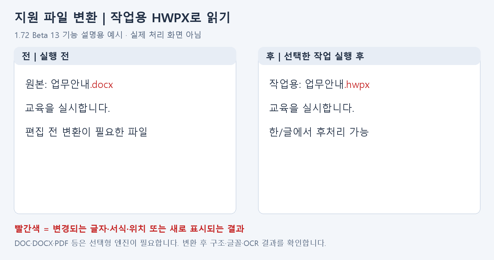](media/features/convert.png)

### 업데이트와 설정 보관

폐쇄망 모드(기본)에서는 업데이트를 확인하지 않으므로 배포 담당자에게 최신 배포판을 받으세요.
설정에서 폐쇄망 모드를 끄면 새 버전이 있을 때 앱이 알립니다.

**Beta 13부터** 업데이트는 실행 중인 앱의 프로세스들을 기다리고, 교체 후 새 앱이 시작됐는지 확인합니다. 새 앱 시작이 확인되지 않으면 이전 실행 파일로 되돌립니다. 업데이트는 설치돼 있던 이전 버전의 업데이트 기능이 수행합니다.

**Beta 15부터** 새 버전을 실행하기 전에 이전 실행 파일의 내부 환경 변수를 지워, 업데이트 뒤 `Failed to load Python DLL` 오류로 새 버전이 켜지지 않던 문제를 고쳤습니다. Beta 13·14에서 올라올 때 이 오류가 나면 실행 파일을 직접 내려받아 바꿔 주세요.

[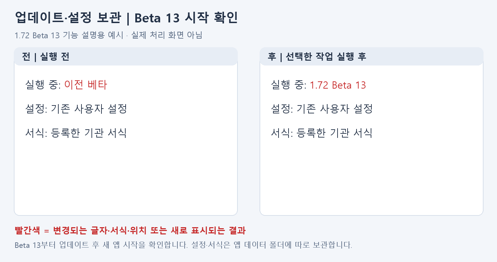](media/features/update.png)

설정과 사용자 서식은 `%APPDATA%\HwpAutoDocFit`에 저장됩니다.
PC를 옮길 때는 앱을 종료하고 이 폴더를 백업하세요. **서식 파일에는 예시 문서 일부가 포함될 수 있으므로 공유에 주의하세요.**

---

## 개발·상세 문서

일반 사용자는 아래 절차 없이 실행 파일만 사용하면 됩니다.

- [세부 처리 규칙과 추가 기능](ADVANCED_USAGE.md)
- [소스로 실행하기·테스트·EXE 빌드](DEVELOPMENT.md)
- [개발 중인 알파의 실행·검증 안내](ALPHA_BATCH_FORMAT.md)
- [개발 인수인계](../HANDOVER.md) · [UI 설계](../UI_DESIGN.md) · [작업 목록](../TODO.md)
- [서식 복사 범위와 설계](../FORMAT_COPY_DESIGN.md) · [원본 보존·재현 설계](../STYLE_FIDELITY_DESIGN.md)

`main`은 정식 배포 브랜치이고 `alpha`는 새 기능 시험 브랜치입니다.

---

## 참고 자료와 사용한 코드

이 프로그램이 직접 쓰거나 함께 배포하는 외부 코드와, 규칙을 만들 때 참고한 자료입니다. 라이선스 전문은 [THIRD_PARTY_NOTICES.md](../THIRD_PARTY_NOTICES.md)에 있습니다.

### 함께 쓰는 프로그램·코드

| 이름 | 쓰는 곳 | 라이선스 |
|---|---|---|
| [kordoc](https://github.com/chrisryugj/kordoc) v4 (© 2026 chrisryugj, [GitLab](https://gitlab.aigov.go.kr/chrisryugj/kordoc)) | 파일 변환·고급 문서 도구의 DOC·DOCX·PDF 등 변환. EXE에 Node.js와 함께 포함하며, kordoc이 쓰는 패키지·모델은 각자의 라이선스를 따릅니다. | MIT |
| [rhwp](https://github.com/edwardkim/rhwp) (`@rhwp/core` 0.8.7, Edward Kim) | 설정·서식 요소·세부 작업의 한/글 조판 미리보기(WASM) | MIT |
| [React](https://react.dev/) · [React Flow(@xyflow/react)](https://reactflow.dev/) · [Vite](https://vite.dev/) | 표/다이어그램 편집기, 미리보기 빌드 | MIT |
| 한컴 한/글 자동화 보안 모듈 예제 (`MapoHwpAutoDocFitSecurity.dll`) | 한/글 COM 자동화 승인(`RegisterModule`). 한컴 예제 바이너리의 파일 이름만 바꿔 함께 배포합니다. | 한글과컴퓨터 예제 배포 조건 |
| 한/글 2020 COM(HWPFrame.HwpObject) | 문서 열기·서식 적용·저장. 사용자 PC에 설치된 한/글을 씁니다(포함하지 않음). | 한/글 사용권 |
| [pywin32](https://github.com/mhammond/pywin32) | 한/글 COM 연결 | PSF |
| [tkinterdnd2](https://github.com/Eliav2/tkinterdnd2) | 파일 끌어다 놓기 | MIT |
| [Pillow](https://python-pillow.org/) | 화면·예시 이미지 처리 | MIT-CMU(HPND) |
| [defusedxml](https://github.com/tiran/defusedxml) | HWPX XML 안전 파싱 | PSF |
| [pywebview](https://pywebview.flowrl.com/) | 웹 화면 창 | BSD-3-Clause |
| [Flutter](https://flutter.dev/) | 새 화면(flutter_ui) | BSD-3-Clause |
| [Noto Sans KR](https://fonts.google.com/noto/specimen/Noto+Sans+KR) | Flutter 화면 글꼴(`flutter_ui/assets`) | SIL OFL 1.1 |
| [PyInstaller](https://pyinstaller.org/) | 실행 파일(exe) 빌드 | GPL-2.0(부트로더 예외) |
| Python 표준 라이브러리·Tcl/Tk | 앱 실행 환경(exe에 포함) | PSF · Tcl/Tk License |

### 규칙을 만들 때 참고한 자료

- 국립국어원 [공공언어 바로 쓰기 자료](https://www.korean.go.kr/common/download.do?c_file_name=d2a561f4-ad8b-4400-826d-4e4e886e2c3d.pdf&file_path=etcData): 공공언어 교정 제안(금번 → 이번 등)
- 국립국어원 [온라인가나다 답변](https://www.korean.go.kr/front/onlineQna/onlineQnaView.do?mn_id=90&pageIndex=1&qna_seq=328160)과 「한글 맞춤법」: 맞춤법 교정 제안
- 행정안전부 「행정업무운영 편람」: 날짜·기간·시간 표기(2026. 3. 1.~6. 30.)
- 행정안전부 개조식 보고서 작성 표준: 항목기호 계층(□ → ㅇ → - → ·/*)과 들여쓰기
- 한/글 HWPX(OWPML) 문서 구조와 한/글 자동화(HwpAutomation) 공개 자료: HWPX 분석·서식 복사, COM 자동화

교정 제안은 참고용이며 자료 전체를 담은 것이 아닙니다. 적용 전에 내용을 확인해 주세요.

## 라이선스

이 프로그램의 소스 코드는 **MIT 라이선스**를 따릅니다([LICENSE](../LICENSE)).
Copyright (c) 2026 haijun93 (마포구청 공혁준). 함께 쓰는 외부 구성 요소는 위 표와 [THIRD_PARTY_NOTICES.md](../THIRD_PARTY_NOTICES.md)의 각 라이선스를 따릅니다.
