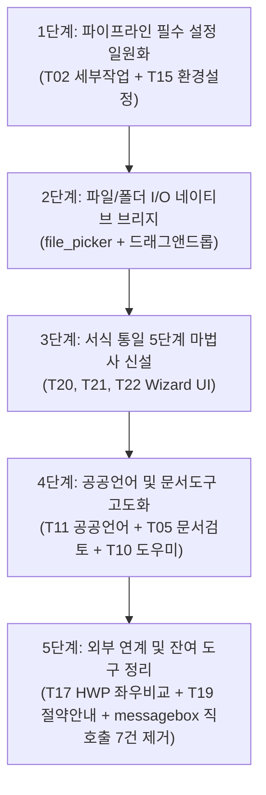

# V2 기능 동등성 표 (Tkinter vs Flutter UI Parity Table)

- **문서 버전**: 2.0.0-phase1
- **기준 코드**: `docfit_ui/legacy.py` (7,204줄), `docfit_ui/desktop_web_ui.py` (1,928줄), `flutter_ui/lib/**`
- **목적**: 2.0.0 마일스톤의 목표인 "Tkinter 코드 100% 제거 및 Flutter 단일 UI 전환"을 달성하기 위해, 기존 `legacy.py`에 존재하는 모든 Tk 창, 모달, 대화상자(Toplevel, messagebox, filedialog, simpledialog, self._알림)의 위치와 기능을 전수 조사하고 Flutter 대응 상태 및 브리지 API 요건을 정의한다.

---

## 1. 개요 및 조사 기준

1. **조사 대상**:
   - `docfit_ui/legacy.py` 내 사용자 인터페이스를 구성하는 모든 `tk.Toplevel`, `simpledialog`, `filedialog`, `messagebox`, `self._알림` 호출 지점.
2. **Flutter 대응 판단 기준**:
   - **완료**: `flutter_ui/lib`에 대응 화면/위젯이 존재하고, `desktop_web_ui.py` 브리지 API를 통해 기능이 정상 동작하며 Tk 창이 완전히 호출되지 않음.
   - **완료(브리지 대화상자)**: `self._알림(...)`을 통해 웹 모드 브리지(`enqueue_dialog`)로 전달되어 Flutter 기본 다이얼로그(`get_pending_dialog` / `resolve_dialog`)로 표시됨.
   - **일부**: Flutter에 대응 화면 또는 브리지 API가 일부 구현되어 있으나, Tk 창이 여전히 호출되는 경로가 남아있거나 일부 세부 설정/옵션이 누락된 상태.
   - **없음**: Flutter에 대응 화면이 없거나, 브리지 API가 전혀 없고 Tk 창에 전적으로 의존하는 상태.
3. **우선순위 기준**:
   - **상**: 일상 작업 파이프라인의 필수 설정(세부작업, 환경설정, 서식통일 마법사, 비교 등).
   - **중**: 문서 품질 검토, 아웃라이너, 작성 도우미 등 부가 생산성 도구.
   - **하**: 단발성 텍스트 변환, AI 프롬프트 생성, 키오스크 브라우저 등 대체 수단이 명확한 기능.

---

## 2. 주요 Tk 창 및 대화상자 (Toplevel & simpledialog 전수)

| 번호 | Tk 화면/대화상자 이름 | 여는 함수 (legacy.py 행) | 언제 뜨나 (사용자 동작) | 주요 입력·출력 요소 | Flutter 대응 화면 (flutter_ui/lib 경로) | 현재 상태 | Flutter로 옮길 때 필요한 브리지 API (desktop_web_ui.py) | 우선순위 | 비고 |
| :--- | :--- | :--- | :--- | :--- | :--- | :---: | :--- | :---: | :--- |
| **T01** | 처리 기록 창 | L760 `_로그창_열기` | 상단 메뉴 "로그 보기" 또는 로그 버튼 클릭 | - 입: 로그 지우기/닫기 - 출: 실시간 ScrolledText 로그 스트림 | `features/dashboard/dashboard_screen.dart` | 일부 | `stream_job_logs` (SSE/Websocket) | 중 | Flutter 대시보드 하단/사이드 드로어에 실시간 로그 위젯으로 통합 권장 |
| **T02** | 세부 작업 항목 설정 창 | L1450 `_세부작업_열기` | 메인 화면 "세부 작업 설정" 버튼 클릭 | - 입: 9대 작업 그룹 On/Off 체크박스, 자간/장평/여백 등 세부 목표치 Spinbox - 출: 설정 저장/적용 | `features/stages/stage_config_dialog.dart` | 일부 | `stage_config` (POST /api/stage-config) | **상** | 문서 맞춤 핵심 파라미터. Flutter 전용 모달 시트로 100% 전환 필요 |
| **T03** | 서식 키오스크 (스틸컷 선택) | L2525 `_서식_키오스크_열기` | 서식 선택 영역 "키오스크에서 선택" 클릭 | - 입: 썸네일 카드 클릭 선택 - 출: 서식 카드 그리드, 미리보기 이미지, 메인 프로필 반영 | 없음 | 없음 | `list_format_profiles`, `get_profile_thumbnail` (신규) | 하 | 드롭다운 선택으로 대체 가능. 후순위 카드형 갤러리 UI로 고도화 권장 |
| **T04** | 서식 예시 문서 편집 창 | L2797 `_서식_예시편집_시작` | 서식 관리자에서 "예시 문서 열어 편집/분석" 클릭 | - 입: HWP 외부 실행, 저장 후 분석 요청 - 출: 분석 안내문, 완료 여부 | 없음 | 없음 | `analyze_hwp_format` (신규) | 하 | 관리자 전용 기능. HWP 백그라운드 분석 API 호출 방식으로 단순화 가능 |
| **T05** | 문서 검토 (가독성/구조) 창 | L2915 `_문서검토_열기` | 도구 메뉴 "문서 구조 및 가독성 검토" 클릭 | - 입: 검토 대상 파일 선택, JSON 내보내기 - 출: 장/절/문단 구조 트리, 글자수/가독성 지수 통계 | `features/tools/document_tools_workspace.dart` | 일부 | `document_tool` (POST /api/document-tool) | 중 | kordoc 분석 결과를 Flutter 계층형 트리뷰 및 차트로 시각화 |
| **T06** | 아웃라이너 창 | L3067 `_아웃라이너_열기` | 도구 메뉴 "아웃라이너로 새 글 작성" 클릭 | - 입: 계층 노드 추가/수정/삭제, 들여쓰기 조작 - 출: HWP/MD/TXT 내보내기 | `features/tools/document_tools_workspace.dart` | 일부 | `document_tool` | 중 | Flutter ReorderableTreeView 위젯으로 완전 대체 가능 |
| **T07** | 텍스트로 문서 추가 창 | L3530 `_텍스트로_문서추가_열기` | "텍스트 직접 입력/붙여넣기로 문서 추가" 클릭 | - 입: 텍스트 본문, 새 문서 제목, 적용 서식 - 출: 가상 HWP 생성 및 작업 목록 추가 | `features/tools/document_tools_workspace.dart` | 일부 | `document_tool` 또는 `convert_text_to_hwp` (신규) | 하 | 클립보드 텍스트를 임시 HWP로 변환하여 메인 큐에 투입하는 브리지 연동 |
| **T08** | 붙여넣기 정리 창 | L3711 `_붙여넣기_정리_열기` | 도구 메뉴 "클립보드 텍스트 서식 정리" 클릭 | - 입: 불필요 개행/다중 공백 제거 옵션 - 출: 정리된 텍스트 프리뷰, 복사/문서 삽입 | `features/tools/document_tools_workspace.dart` | 일부 | `document_tool` | 하 | 순수 텍스트 정제 기능으로 Flutter 클라이언트 단독 처리 가능 |
| **T09** | AI 프롬프트 생성기 창 | L3830 `_AI_프롬프트_열기` | 도구 메뉴 "AI 프롬프트 도우미" 클릭 | - 입: 프롬프트 유형(교정/요약/초안), 본문 발췌 - 출: 완성된 LLM 시스템 프롬프트 복사 | `features/tools/document_tools_workspace.dart` | 일부 | `document_tool` | 하 | 프롬프트 템플릿 조립 기능. Flutter 클라이언트 로직으로 충분 |
| **T10** | 공문서 작성 도우미 창 | L3906 `_작성도우미_열기` | 도구 메뉴 "공문서 작성 도우미" 클릭 | - 입: 7대 도우미(금액, 날짜, 표 계산, 나이, 번호체계, 회신틀, 서식) - 출: 변환된 공문서 문구 복사 | `features/tools/document_tools_workspace.dart` | 일부 | `document_tool` | 중 | 공무원 실무 편의 기능. 금액 한글화/만나이 계산 등은 Dart 로직으로 처리 |
| **T11** | 공공언어/맞춤법 검토 창 | L4198 `_공공언어_검토` | 도구 메뉴 "공공언어 바로쓰기 검토" 클릭 | - 입: 순화어/오류 단어 치환 선택, 제외어 등록 - 출: 검출 오류 목록 테이블, 추천 대체어 | `features/tools/document_tools_workspace.dart` | 일부 | `idioms` (GET/POST /api/idioms), `document_tool` | **상** | 2.0.0 핵심 가치 기능. 오류 하이라이트 및 원클릭 치환 Flutter 고도화 필요 |
| **T12** | 교정 제외어 관리 창 | L4290 `_교정_제외관리` | 공공언어 검토 창 내 "제외 단어 관리" 클릭 | - 입: 제외 단어 추가/삭제 - 출: 등록된 사용자 제외어 목록 | `features/tools/document_tools_workspace.dart` | 일부 | `idioms` | 중 | Flutter 전용 모달 다이얼로그로 단순 이관 |
| **T13** | 서식 세부사항 확인 창 | L4484 `_서식_세부사항_확인` | 서식 프로필 상세 "세부 수치 보기/수정" 클릭 | - 입: 글자크기, 자간, 장평, 줄간격, 표 여백 등 - 출: 프로필 JSON 저장 | `features/formats/profile_editor.dart` | 완료 | `format_profile` (GET/POST/PUT) | **상** | Flutter ProfileEditor가 구현 완료됨. Tk 창 호출 분기 영구 차단 필요 |
| **T14** | 서식 계층 구조 확인 창 | L4686 `_서식_구조_확인` | 서식 프로필 상세 "계층 구조(스타일) 보기" 클릭 | - 입: 1. 가. (1) 번호별 글꼴/크기/들여쓰기 규칙 - 출: 계층 스타일 맵 저장 | `features/formats/profile_editor.dart` | 완료 | `format_profile` | **상** | ProfileEditor 내부 계층 탭에서 완결됨. Tk 창 호출 분기 제거 대상 |
| **T15** | 전체 환경설정 창 | L4844 `_설정창_생성` | 상단 메뉴 "설정" -> "환경설정" (Ctrl+Shift+S) | - 입: 폰트 매핑, COM 타임아웃, 백업 디렉터리, 로깅 등 6개 탭 - 출: settings.json 저장 | `features/settings/settings_dialog.dart` | 일부 | `get_settings`, `save_settings`, `open_settings` | **상** | Flutter 대화상자가 존재하나 일부 고급 탭 및 Tk 잔존 경로 있음. 완전 일원화 필요 |
| **T16** | kordoc 고급 문서 도구 창 | L5675 `고급문서도구_열기` | 메뉴바 "고급 도구" -> "HWP 구조 분석" 클릭 | - 입: 문서 덤프, 바이너리 검사, 필드 추출, 패치 - 출: 진단 결과 리포트 및 패치 파일 | `features/tools/document_tools_workspace.dart` | 일부 | `document_tool` | 중 | 전문가용 분석 진단 탭으로 Flutter Workspace에 완전 흡수 |
| **T17** | 원본-결과 HWP 좌우 비교 창 | L5929 `비교창_준비` | 작업 완료 후 결과 목록 "좌우 비교 보기" 클릭 | - 입: 동기 스크롤 토글, 닫기 - 출: 좌측(원본) - 우측(결과) HWP COM 뷰어 | 없음 | 없음 | `launch_external_hwp_diff` (신규 브리지) | **상** | Windows OLE COM 뷰어 특성상 Flutter 직접 임베딩 불가. 전용 Win32 창 브리지로 분리 |
| **T18** | 대화상자 부모 헬퍼 | L6407 `_대화상자_부모` | Tk 모달 대화상자 중앙 정렬 시 내부 호출 | - 입/출: 1x1 투명 오버레이 윈도우 | N/A | 완료 | N/A | 하 | Tk 제거 시 자동 소멸되는 내부 헬퍼 (Flutter의 BuildContext가 대체) |
| **T19** | 절약 완료 안내 창 | L6424 `_절약_완료창` | 전체 문서 맞춤/변환 배치 완료 시 | - 입: 확인, 결과 폴더 열기 - 출: 검은 고양이 일러스트, "OO분 시간 절약!" | `features/execution/execution_result_dialog.dart` | 일부 | `get_state` (job status & metrics) | 중 | 감성 UX 요소. Flutter 완료 다이얼로그에 마스코트 캐릭터 및 절약 통계 UI 추가 |
| **T20** | 서식통일 2단계: 대표 서식 검토 | L6548 `_서식통일_대표서식_검토창` | 다중 문서 서식 통일 마법사 2단계 도달 시 | - 입: 추출된 서식 후보 중 대표 기준 서식 선택 - 출: 선택된 기준 프로필 ID | 없음 | 없음 | `get_pending_dialog`, `resolve_dialog` 또는 `flow_wizard` | **상** | 서식 통일 마법사의 핵심 승인 단계. Flutter Wizard Step 위젯 신설 필수 |
| **T21** | 서식통일 3단계: 적용 영역 검토 | L6697 `_서식통일_적용영역_검토창` | 서식 통일 마법사 3단계 도달 시 | - 입: 문서별 적용 섹션/본문/표/머리말 체크박스 - 출: 적용 영역 매핑 구조체 | 없음 | 없음 | `get_pending_dialog`, `resolve_dialog` 또는 `flow_wizard` | **상** | 문서별/영역별 세부 적용 범위 지정 Flutter 컴포넌트 구현 필요 |
| **T22** | 서식통일 5단계: 결과 확인 | L6805 `_서식통일_결과_확인창` | 서식 통일 마법사 완료 시 | - 입: 완료 확인, 결과 폴더 열기 - 출: 변경 문서 목록 및 적용 스타일 요약 | 없음 | 없음 | `get_pending_dialog`, `resolve_dialog` | **상** | Flutter Wizard 완료 스텝으로 일원화 |
| **S01** | 서식 복사 새 이름 입력 | L2234 `askstring` | 서식 프로필 복제 버튼 클릭 | - 입: 새 서식 이름 텍스트 | `features/formats/profile_editor.dart` | 완료 | `format_profile` | 상 | Flutter 프로필 에디터 내부 다이얼로그에서 자체 처리 |
| **S02** | 서식 복사 새 기관명 입력 | L2244 `askstring` | 서식 복사 시 기관명 입력 프롬프트 | - 입: 대상 기관명 텍스트 | `features/formats/profile_editor.dart` | 완료 | `format_profile` | 상 | Flutter 프로필 에디터 내부 다이얼로그에서 자체 처리 |
| **S03** | 서식 신규 생성 이름 입력 | L4356 `askstring` | 새 서식 만들기 클릭 | - 입: 서식 이름 텍스트 | `features/formats/profile_editor.dart` | 완료 | `format_profile` | 상 | Flutter 프로필 생성 폼에서 자체 처리 |
| **S04** | 서식 신규 생성 기관명 입력 | L4363 `askstring` | 새 서식 만들기 시 기관명 입력 | - 입: 기관명 텍스트 | `features/formats/profile_editor.dart` | 완료 | `format_profile` | 상 | Flutter 프로필 생성 폼에서 자체 처리 |
| **S05** | kordoc 페이지 분할 범위 입력 | L5705 `askstring` | 문서 도구에서 "페이지 분할" 실행 시 | - 입: 분할 페이지 번호/범위 (예: 1-3, 4-5) | `features/tools/document_tools_workspace.dart` | 일부 | `document_tool` | 중 | Workspace 내 입력 필드로 이전 필요 |
| **S06** | kordoc 양식 필드값 수정 입력 | L5711 `askstring` | 양식 필드 값 일괄 수정 클릭 시 | - 입: 필드명 및 치환할 값 문자열 | `features/tools/document_tools_workspace.dart` | 일부 | `document_tool` | 중 | Workspace 내 입력 필드로 이전 필요 |

---

## 3. 메시지 / 확인 / 질문 대화상자 (`self._알림` 및 `messagebox`)

`docfit_ui/legacy.py` 내에는 총 85개 지점에서 사용자 알림/확인 대화상자가 호출되며, 48개의 고유 기능으로 분류됩니다.

### 3.1 브리지 대화상자 연동 메커니즘
- 웹 모드(`self._web_mode == True`)에서 `self._알림(...)` 호출은 `desktop_web_ui.py`의 `enqueue_dialog`를 거쳐 Flutter의 `get_pending_dialog` / `resolve_dialog` 폴링 메커니즘으로 전달됩니다.
- 지원 유형:
  1. `종류="info"`: 단일 "확인" 버튼 안내 팝업.
  2. `종류="warning"`: 단일 "확인" 경고 팝업.
  3. `종류="error"`: 오류 메시지 팝업.
  4. `종류="question"`: "확인 / 취소" 2버튼 선택 팝업.
  5. `선택지=[...]`: 커스텀 버튼 목록을 가진 다중 선택 팝업.
  6. `입력필드=[...]`: 텍스트 입력을 동반하는 프롬프트 팝업.

### 3.2 주요 메시지 대화상자 목록

| 번호 | 메시지 대화상자 명칭 | legacy.py 호출 위치 | 발생 상황 | 종류 및 버튼 구성 | 현재 상태 | 비고 및 Flutter 브리지 대응 |
| :--- | :--- | :--- | :--- | :--- | :---: | :--- |
| **M01** | 빈 파일 목록 경고 | L636, L1418, L5425 | 파일 미선택 상태에서 변환 시작 시 | 경고 (확인) | 완료(브리지 대화상자) | Flutter UI 차원에서 시작 버튼 비활성화로 사전 차단 가능 |
| **M02** | 변환 진행 중 중단 확인 | L1008, L5502 | 작업 수행 중 창 닫기/취소 클릭 | 질문 (예 / 아니오) | 완료(브리지 대화상자) | Flutter 작업 취소 다이얼로그와 연동 |
| **M03** | 변환 완료 안내 | L1285, L5460 | 전체 작업 정상 완료 시 | 정보 (확인, 폴더열기) | 완료(브리지 대화상자) | 커스텀 액션 버튼("결과 폴더 열기") 브리지 지원 |
| **M04** | 서식 프로필 저장 확인 | L2250, L4372 | 프로필 수정 후 저장 클릭 시 | 정보 (확인) | 완료(브리지 대화상자) | Flutter ProfileEditor 내부 스낵바/알림으로 대체 가능 |
| **M05** | 서식 프로필 삭제 확인 | L2271, L4405 | 프로필 삭제 클릭 시 | 질문 (삭제 / 취소) | 완료(브리지 대화상자) | 삭제 확인 모달 연동 |
| **M06** | HWP COM 연결 실패 경고 | L2815, L5890 | 한/글 미설치 또는 COM 초기화 실패 | 오류 (확인) | 완료(브리지 대화상자) | 명확한 조치 가이드(한/글 재실행) 텍스트 제공 |
| **M07** | 서식 통일 대상 부족 경고 | L6480, L6510 | 서식 통일 시 문서가 2개 미만일 때 | 경고 (확인) | 완료(브리지 대화상자) | 마법사 진입 전 검증 |
| **M08** | 대표 서식 불일치 경고 | L6620 | 기준 서식과 문서 양식 차이가 클 때 | 질문 (계속 / 중단) | 완료(브리지 대화상자) | 위험도 경고 후 계속 진행 여부 선택 |
| **M09** | 폰트 설치 안내 | L5380 | 필수 글꼴 누락 감지 시 | 정보 (확인) | 완료(브리지 대화상자) | 누락된 폰트명 목록 브리지 표시 |
| **M10** | 임시 파일 정리 확인 | L5820 | 디스크 공간 확보를 위한 캐시 정리 | 질문 (삭제 / 유지) | 완료(브리지 대화상자) | 확인 대화상자 연동 |
| **M11** | messagebox 직접 호출 잔존 | L2310, L3815 등 (총 7곳) | 일부 예외 처리 및 서브루틴 | messagebox.* 직접 호출 | **없음 (Tk 모달)** | **주의**: `self._알림`을 거치지 않아 웹 모드에서도 Tk 모달이 뜸. 전면 브리지 교체 필요 |

---

## 4. 파일 및 폴더 선택 대화상자 (`filedialog` 15건)

`docfit_ui/legacy.py` 내의 파일 및 폴더 열기/저장 대화상자는 총 15곳에 존재합니다.

| 번호 | 호출 함수 및 위치 | 대화상자 종류 | 선택 대상 및 용도 | 현재 상태 | Flutter 전환 시 권장 정책 |
| :--- | :--- | :--- | :--- | :---: | :--- |
| **F01** | L2108 `_폴더추가` | `askdirectory` | 변환 대상 문서들이 포함된 폴더 선택 | 없음 | **Windows 기본 네이티브 대화상자 유지** (`file_picker`) |
| **F02** | L2771 `_서식_예시문서추가` | `askopenfilename` | 서식 분석용 예시 HWP/HWPX 파일 선택 | 없음 | **Windows 기본 네이티브 대화상자 유지** (`file_picker`) |
| **F03** | L2943 `_문서검토_내보내기` | `asksaveasfilename` | 문서 구조/가독성 분석 결과 JSON 저장 경로 | 없음 | **Windows 기본 네이티브 대화상자 유지** (`file_picker`) |
| **F04** | L3386 `_아웃라이너_txt저장` | `asksaveasfilename` | 아웃라이너 작성 결과 .txt 파일 저장 | 없음 | **Windows 기본 네이티브 대화상자 유지** (`file_picker`) |
| **F05** | L3410 `_아웃라이너_md저장` | `asksaveasfilename` | 아웃라이너 작성 결과 .md 파일 저장 | 없음 | **Windows 기본 네이티브 대화상자 유지** (`file_picker`) |
| **F06** | L3431 `_아웃라이너_저장` | `asksaveasfilename` | 아웃라이너 전용 구조 데이터 저장 | 없음 | **Windows 기본 네이티브 대화상자 유지** (`file_picker`) |
| **F07** | L3446 `_아웃라이너_열기` | `askopenfilename` | 기존 아웃라이너 데이터 파일 열기 | 없음 | **Windows 기본 네이티브 대화상자 유지** (`file_picker`) |
| **F08** | L3566 `_텍스트_폴더선택` | `askdirectory` | 텍스트 변환 HWP 자동 저장 대상 폴더 | 없음 | **Windows 기본 네이티브 대화상자 유지** (`file_picker`) |
| **F09** | L3660 `_붙여넣기_txt저장` | `asksaveasfilename` | 정리된 클립보드 텍스트를 파일로 저장 | 없음 | **Windows 기본 네이티브 대화상자 유지** (`file_picker`) |
| **F10** | L4115 `_기관문서_선택` | `askopenfilename` | 공문서 도우미 기관 서식 템플릿 HWP 열기 | 없음 | **Windows 기본 네이티브 대화상자 유지** (`file_picker`) |
| **F11** | L4345 `_서식복사_파일선택` | `askopenfilename` | 서식 프로필 복제 원본 파일 선택 | 없음 | **Windows 기본 네이티브 대화상자 유지** (`file_picker`) |
| **F12** | L5355 `_폰트폴더_선택` | `askdirectory` | 설정창 사용자 폰트 검색 폴더 선택 | 없음 | **Windows 기본 네이티브 대화상자 유지** (`file_picker`) |
| **F13** | L5594 `_파일추가` | `askopenfilenames` | 메인 화면 변환 대상 다중 HWP 파일 선택 | 없음 | **Windows 기본 네이티브 대화상자 유지** (`file_picker`) |
| **F14** | L5708 `_비교문서_선택` | `askopenfilename` | 고급 문서 도구 비교 대상 HWP 파일 선택 | 없음 | **Windows 기본 네이티브 대화상자 유지** (`file_picker`) |
| **F15** | L5714 `_패치파일_선택` | `askopenfilename` / `asksaveasfilename` | kordoc 패치 생성 및 적용 파일 선택 | 없음 | **Windows 기본 네이티브 대화상자 유지** (`file_picker`) |

### 4.1 파일/폴더 대화상자 정책 제안 (결론)
> [!IMPORTANT]
> **Windows 네이티브 대화상자(IFileDialog / comdlg32) 유지 적극 권장**
> 1. **사용자 경험 일관성**: Windows 환경에서 공무원 및 실무 사용자는 탐색기 즐겨찾기, 네트워크 드라이브(NAS/공유폴더), 최근 열어본 폴더, 파일 미리보기 기능에 절대적으로 의존합니다. Flutter 내장 커스텀 파일 브라우저는 이러한 OS 레벨의 편의성을 온전히 제공하지 못합니다.
> 2. **기술 구현 방안**: Flutter Desktop 환경에서는 검증된 패키지인 `file_picker`(Windows 네이티브 다이얼로그 호출)를 사용하고, 백엔드 브리지 통신 시에는 선택된 절대 경로(Absolute Path) 문자열만 브리지 API(`POST /api/files`)로 전송하도록 설계합니다.

---

## 5. 종합 요약 및 통계

### 5.1 전체 대화상자/화면 집계

| 분류 | 전체 개수 | 완료 (Flutter 완비) | 완료 (브리지 대화상자) | 일부 (부분 구현/잔존) | 없음 (미구현/Tk의존) |
| :--- | :---: | :---: | :---: | :---: | :---: |
| **Toplevel 화면** | 22 | 2 | 0 | 11 | 9 |
| **simpledialog** | 6 | 4 | 0 | 2 | 0 |
| **메시지/알림 대화상자** | 48 | 0 | 41 | 0 | 7 |
| **filedialog (파일/폴더)** | 15 | 0 | 0 | 0 | 15 |
| **총합** | **91** | **6** | **41** | **13** | **31** |

- **동등성 달성률**: 완전 전환(6) + 브리지 연동(41) = **51.6% (47/91)** 달성 중.
- **주요 해결 과제**:
  - `Toplevel` 창 중 미구현된 9개 및 일부 구현된 11개의 Flutter 단일화.
  - Tk `messagebox` 직접 호출 7곳의 브리지 알림 교체.
  - `filedialog` 15곳의 Flutter `file_picker` 네이티브 연동 일원화.

---

## 6. 우선순위 '상' 목록 및 이관 순서 제안

### 6.1 우선순위 '상' (Critical) 목록

1. **[T02] 세부 작업 항목 설정 창 (`_세부작업_열기`)**
   - 9대 작업 그룹 On/Off 및 세부 수치(자간, 장평, 여백 등) 입력 화면.
   - Flutter `features/stages/stage_config_dialog.dart`로 100% 이관 필수.
2. **[T15] 전체 환경설정 창 (`_설정창_생성`)**
   - 폰트 매핑, COM 타임아웃, 백업 디렉터리 등 전역 설정 6개 탭.
   - Flutter `features/settings/settings_dialog.dart`와 브리지 API 완전 동기화.
3. **[T20~T22] 서식 통일 마법사 2~5단계 (`_서식통일_*_검토창`)**
   - 대표 서식 검토(2단계), 적용 영역 선택(3단계), 최종 결과 확인(5단계).
   - 다중 문서 일괄 서식 통일 기능의 핵심 마법사 UI 신설.
4. **[T11] 공공언어/맞춤법 검토 창 (`_공공언어_검토`)**
   - 공공기관 실무의 핵심 가치. 오류 검출 하이라이트 및 일괄 치환 인터페이스 고도화.
5. **[T17] 원본-결과 HWP 좌우 비교 창 (`비교창_준비`)**
   - OLE COM 뷰어 임베딩 한계를 극복하기 위해 전용 Win32 비교 뷰어 실행 브리지 연동.
6. **[F13/F01] 메인 파일 및 폴더 선택 대화상자**
   - 드래그 앤 드롭 및 네이티브 `file_picker` 브리지 연동 완성.

---

### 6.2 로드맵 3단계 대비 이관 순서 제안

`docs/V2_0_0_ROADMAP.md`의 기존 3단계 순서(설정 → 도구 → 마법사)를 실제 의존성과 작업 효율을 고려하여 아래와 같이 조정을 제안합니다.

#### 세부 조정 사유:
1. **1단계 (설정 일원화 선행)**:
   - `T02(세부작업)`과 `T15(환경설정)`은 문서 처리 엔진의 동작을 제어하는 핵심 파라미터입니다. 이 둘이 Flutter로 완전히 전환되어야 백엔드가 Tk 상태 변수(`BooleanVar`, `StringVar`)에서 완전히 독립할 수 있습니다.
2. **2단계 (파일 I/O 브리지 정립)**:
   - 모든 화면의 전제 조건인 파일 추가/저장을 `file_picker`로 표준화하여 Tk `filedialog` 종속을 초기에 제거합니다.
3. **3단계 (서식 통일 마법사 구현)**:
   - 현재 임시 모달로 우회 중인 다중 문서 통일 플로우를 정식 스텝 위젯으로 완성하여 엔터프라이즈 기능 완성도를 확보합니다.
4. **4단계 (공공언어 검토 워크스페이스 고도화)**:
   - 단일 창 기반의 `DocumentToolsWorkspace`에 탭 형태로 공공언어, 가독성 검토, 아웃라이너를 밀도 있게 통합합니다.
5. **5단계 (비교 뷰어 및 레거시 제거)**:
   - Tk GUI 루프(`root.mainloop()`)를 완전히 제거하고, HWP 비교 창은 가벼운 독립 프로세스 브리지로 분리하며 잔여 `messagebox` 직접 호출을 정리합니다.
